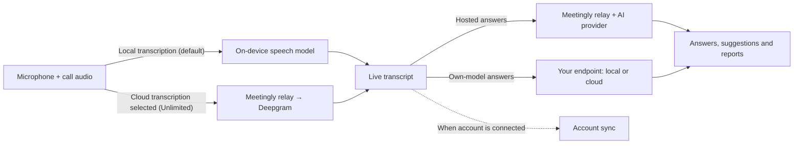

<p align="center"><b>Patrocinado por <a href="https://aiprimetech.io">AI Prime Tech</a></b>: una pasarela de API de AI con acceso barato a la API de Claude y la API de Codex. Una clave para modelos Claude Code, Codex CLI y GPT.</p>

<div align="center">


# Meetingly: asistente de AI open-source para entrevistas y copiloto de reuniones

**La respuesta, mientras aún están preguntando.**

Meetingly es un asistente de AI gratuito y open-source para entrevistas de trabajo y reuniones en directo en Windows, macOS y Linux. Escucha Zoom, Google Meet, Microsoft Teams o cualquier otra llamada, la transcribe en tu propio ordenador y muestra la respuesta en pantalla en cuanto se hace una pregunta. Usa el plan gratis (50 respuestas al día, sin tarjeta) o trae tu propia clave de OpenAI, OpenRouter u Ollama. Una alternativa gratuita a Cluely, Interview Coder, Final Round AI, LockedIn AI y Parakeet AI.

<p align="center"><!-- languages --><a href="README.md">English</a> · <a href="README.zh-CN.md">简体中文</a> · <a href="README.ru.md">Русский</a> · <b>Español</b> · <a href="README.pt-BR.md">Português</a> · <a href="README.ja.md">日本語</a> · <a href="README.ko.md">한국어</a></p>

<a href="https://meetinglyai.com/download/Meetingly-Setup.exe"></a>
&nbsp;
<a href="https://meetinglyai.com/download/Meetingly-mac-arm64.dmg"></a>
&nbsp;
<a href="https://meetinglyai.com/download/Meetingly-linux.AppImage"></a>

<sub>También: <a href="https://meetinglyai.com/download/Meetingly-mac-x64.dmg">Intel Mac</a> · <a href="https://meetinglyai.com/download/Meetingly-linux.deb">Debian / Ubuntu (.deb)</a> · <a href="https://meetinglyai.com/download/Meetingly.exe">Windows portable</a> · <a href="https://meetinglyai.com">meetinglyai.com</a></sub>


</div>

## Guías prácticas

[Primeros pasos](https://meetinglyai.com/blog/ai-meeting-assistant-without-bot/) · [Flujos de datos locales y en la nube](https://meetinglyai.com/blog/local-vs-cloud-transcription/) · [Configuración de Ollama](https://meetinglyai.com/blog/meetingly-ollama-setup/) · [Plantilla de notas de reunión](https://meetinglyai.com/blog/meeting-notes-template/)

## Funciones

- **Respuestas reales, al instante.** Cuando la otra persona pregunte algo, pulsa *Answer* (o deja que la respuesta automática de Pro lo haga): una línea en negrita que puedas decir y, después, algunos puntos clave para ampliar. Sin consejos ni «podrías mencionar…».
- **Preguntas sugeridas.** Una columna lateral sigue la conversación y ofrece preguntas con un clic: la pregunta que te acaban de hacer, términos que surgieron, la probable siguiente pregunta.
- **Reconocimiento de voz en tu ordenador.** NVIDIA Nemotron transcribe localmente en 28 idiomas de forma predeterminada. Unlimited también ofrece transcripción opcional en la nube, que envía el audio a Deepgram.
- **Tú y ellos, separados.** Tu micrófono y el audio de la llamada se transcriben por separado, así que la transcripción se lee como un chat.
- **Análisis de pantalla.** Un clic lee lo que hay en tu pantalla (una tarea de programación, una diapositiva, una pregunta) y lo responde.
- **Protección del contenido al compartir pantalla.** Usa la protección del sistema operativo en Windows y macOS. Algunos métodos de captura aún pueden incluir la ventana; Linux no ofrece la misma protección.
- **Informes de reunión.** Cada reunión termina con un resumen, decisiones, tareas y seguimientos.
- **Transcripciones guardadas como archivos de texto.** Cada sesión se guarda en *Documents/Meetingly* como un archivo .txt sencillo, con Tú y Ellos en cada turno, así que Meetingly también funciona como una aplicación gratuita de transcripción, sin AI ni cuenta.
- **Tu propia clave de API, o ninguna nuestra.** Usa el plan gratis, o apunta Meetingly a OpenAI, OpenRouter, un modelo local de Ollama o cualquier endpoint compatible con OpenAI.
- **Se actualiza solo** en Windows, macOS y Linux, nunca en medio de una llamada.

**Funciona con** Zoom, Google Meet, Microsoft Teams, reuniones de Slack, Discord, Webex y cualquier otra app que reproduzca la llamada en tu ordenador. Ningún bot se une a la reunión: Meetingly escucha el audio de tu ordenador.

## Para qué lo usa la gente

- **Entrevistas de trabajo.** Responde preguntas conductuales, técnicas y de RR. HH. a partir de tu CV y la descripción del puesto, que pegas una vez en *Instructions*.
- **Entrevistas de programación.** El análisis de pantalla lee la tarea en pantalla (LeetCode, HackerRank, CoderPad, Codility o un editor compartido) y responde con un enfoque y código.
- **Ventas y llamadas con clientes.** La respuesta a la pregunta de un cliente mientras aún está hablando, y después un informe con los siguientes pasos.
- **Reuniones y clases.** Una transcripción en directo en 28 idiomas, preguntas sugeridas y un resumen con decisiones y tareas.

## Dos formas de usarlo

**Cuenta gratis.** Haz clic en *Sign up free* en el panel: 50 respuestas de AI al día, sin tarjeta. Las instrucciones (tu CV, la descripción del puesto), los ajustes y los informes de reunión están en tu [panel web](https://account.meetinglyai.com) y se sincronizan con todos tus ordenadores.

| | Free | Pro | Unlimited |
|---|---|---|---|
| Precio | $0 | $19.99 / mes, 7 días gratis | $39.99 / mes |
| Respuestas | 50 al día | 300 al día | Unlimited (uso razonable) |
| Auto-answer (responde a las preguntas a medida que se hacen) | — (pulsa Answer) | Incluido | Incluido |
| Análisis de pantalla | 3 al día | 50 al día | 300 al día |
| Sugerencias en vivo | Unos 30 minutos al día | Unas 4 horas al día | Unas 8 horas al día |
| Informes de reunión | 1 al día | 20 al día | 100 al día |
| Ordenadores | 1 | 2 | 3 |

Paga con tarjeta, o con SBP o cripto, en la [página de planes](https://account.meetinglyai.com/dashboard/plan). Publica sobre Meetingly y consigue Pro gratis: consulta la [recompensa para creadores](https://meetinglyai.com/creators/).

**Tu propia clave, sin cuenta.** Abre el menú de Meetingly (el icono de la bandeja junto al reloj) y elige *Use your own API key…*, selecciona un proveedor, pega una clave y elige un modelo. Las respuestas van directamente de tu ordenador a ese proveedor; nada pasa por los servidores de Meetingly, y no hay más límites que los de tu proveedor.

| Proveedor | Dirección de API | Clave |
|---|---|---|
| OpenAI | `https://api.openai.com/v1` | de platform.openai.com |
| OpenRouter | `https://openrouter.ai/api/v1` | de openrouter.ai |
| Ollama (totalmente local) | `http://localhost:11434/v1` | ninguna |
| Cualquier cosa compatible con OpenAI (LM Studio, vLLM, LiteLLM…) | su dirección `/v1` | si necesita una |

La versión 1.2.3 requiere un llavero seguro del sistema operativo antes de guardar una clave de API. Las claves existentes en texto plano se migran cuando hay almacenamiento seguro disponible; un llavero no disponible no borra la configuración guardada. El análisis de pantalla necesita un modelo que acepte imágenes.

## Meetingly frente a Cluely, Pluely, Interview Coder, Final Round AI, LockedIn AI y Parakeet AI

| | **Meetingly** | Cluely | Pluely | Interview Coder | Final Round AI | LockedIn AI | Parakeet AI |
|---|---|---|---|---|---|---|---|
| Precio | **Free**, Pro $19.99, Unlimited $39.99 / mes | Plan gratis, Pro $19.99 / mes | Gratis con tus propias claves, Pro desde $15 / mes, $120 de por vida | $299 / mes o $799 de por vida | Pro desde $25 / mes | $54.99 / mes, o $39.99 / mes facturado cada 3 meses | €129.90 / mes, o créditos |
| Respuestas de AI gratis sin tu propia clave | **50 al día, todos los días** | "Respuestas de AI limitadas" | — | Ninguna: la AI necesita una suscripción | Ninguna: las sesiones en directo necesitan Pro | — | Una sesión de 10 minutos |
| Oculto al compartir pantalla | **Todos los planes; se aplican limitaciones del sistema operativo y del método de captura** | Solo Pro + Undetectability, $149.99 / mes | Todos los planes | Todos los planes | Pro | — | Planes de pago |
| Linux | **AppImage y .deb** | — | .deb | — | — | — | Solo en Chrome |
| Open source | **Apache-2.0** | — | GPL-3.0 | — | — | — | — |
| Usa tu propia clave de API | **OpenAI, OpenRouter, Ollama…** | — | Sí | — | — | — | — |
| Reconocimiento de voz en tu ordenador | **Sí, 28 idiomas** | — | — | — | — | — | — |

<sub>De la web de cada producto (<a href="https://cluely.com/pricing">cluely.com/pricing</a>, <a href="https://pluely.com/pricing">pluely.com/pricing</a>, <a href="https://www.interviewcoder.co">interviewcoder.co</a>, <a href="https://www.finalroundai.com/pricing">finalroundai.com/pricing</a>, <a href="https://www.lockedinai.com/pricing">lockedinai.com/pricing</a>, <a href="https://www.parakeet-ai.com/pricing">parakeet-ai.com/pricing</a>), 5–11 de octubre de 2026. — significa que no se menciona allí.</sub>

<div align="center">

</div>

## Cómo funciona



El audio se procesa en tu ordenador cuando se selecciona la transcripción local. Elegir transcripción en la nube en Unlimited envía el audio a Deepgram a través del relé. Las respuestas de AI usan el texto relevante de la transcripción, las preguntas y las capturas de pantalla solicitadas: a través del relé/proveedor alojado, o directamente mediante tu propio endpoint. La sincronización de cuentas conectadas es una ruta de datos separada.

## Notas de instalación

Los instaladores aún no están firmados con código, así que el primer inicio lo pedirá una vez:

- **Windows:** SmartScreen dice que la app no se reconoce. Haz clic en *Más información* y luego en *Ejecutar de todos modos*.
- **macOS:** abre Ajustes del Sistema → Privacidad y seguridad y haz clic en *Abrir de todos modos*. Mantén la app en Aplicaciones para que pueda actualizarse sola.
- **Linux:** `chmod +x Meetingly-linux.AppImage` y ejecútalo, o instala el .deb.

## Desarrollo

```bash
cd app
npm install
npm run fetch:asr   # speech engine for your platform
npm run dev
```

| Comando | Qué hace |
|---|---|
| `npm run dev` | Ejecuta con recarga en caliente |
| `npm test` | Pruebas unitarias |
| `npm run typecheck` | Comprueba tipos en main y renderer |
| `npm run smoke` | Abre cada ventana en modo headless y falla ante errores de renderer (`node scripts/smoke.mjs ownkey` prueba el flujo con clave propia) |
| `npm run dist:win` | Genera el instalador de Windows (macOS y Linux se generan en GitHub Actions) |

```
app/      desktop app: Electron 44, React 19, Vite 8, TypeScript, Tailwind
relay/    the small Node service behind the Free, Pro and Unlimited plans (holds the API keys, picks the model per task)
docs/     images for this page
```

## FAQ

### ¿Meetingly es gratis?

Sí. El plan gratis da 50 respuestas de AI al día sin tarjeta, en un ordenador. Con tu propia clave de API no hay ningún límite de Meetingly. El código es open source bajo Apache-2.0.

### ¿Meetingly es una alternativa a Cluely?

Sí. Hace el mismo trabajo (respuestas en directo en una superposición durante una llamada), y es open source, también funciona en Linux, se oculta al compartir pantalla en el plan gratis y funciona con tu propia clave de API o un modelo local.

### ¿Funciona con Zoom, Google Meet y Microsoft Teams?

Sí, y con cualquier otra app de llamadas. Meetingly captura el audio de tu ordenador (loopback en Windows, una toma de audio en macOS 13 y posteriores, dispositivos de monitor PulseAudio en Linux), así que nada se une a la reunión y la otra parte no ve ningún bot.

### ¿Se oculta al compartir pantalla? ¿Es indetectable?

En Windows y macOS, las ventanas usan la protección de captura de pantalla del sistema operativo, por lo que las pantallas compartidas y las grabaciones normalmente las excluyen. Algunos métodos de captura aún pueden incluirlas, Linux no tiene esa protección y Meetingly no está creado para eludir software de supervisión. Ninguna herramienta puede prometer honestamente ser indetectable.

### ¿Puede ayudar en entrevistas de programación?

Sí. El análisis de pantalla toma una captura solo cuando lo pulsas, lee la tarea (LeetCode, HackerRank, CoderPad, Codility o cualquier editor) y responde con un enfoque y código. Con tu propia clave, elige un modelo que acepte imágenes.

### ¿Puedo usarlo solo para transcribir, sin AI?

Sí. Pulsa Listen y Meetingly transcribe la llamada en tu ordenador en 28 idiomas, sin límite de tiempo, y guarda cada sesión como un archivo .txt en *Documents/Meetingly*. Las sugerencias en directo y el auto-answer están desactivados al principio; el único paso de AI que se ejecuta por sí solo es el informe al final de una reunión.

### ¿Puede funcionar totalmente sin conexión?

El reconocimiento de voz ya se ejecuta en tu ordenador: NVIDIA Nemotron, descargado una vez (unos 560 MB). Dirige las respuestas a un modelo local de Ollama y nada sale de tu ordenador.

### ¿Qué idiomas admite?

28, tanto para transcripción como para respuestas: inglés, árabe, búlgaro, chino, croata, checo, danés, neerlandés, estonio, finés, francés, alemán, hindi, húngaro, italiano, japonés, coreano, noruego, polaco, portugués, rumano, ruso, eslovaco, español, sueco, turco, ucraniano y vietnamita.

### ¿Dónde se almacenan mis datos?

Las transcripciones y los informes se guardan en tu ordenador. Con una cuenta gratuita, tus Instructions, ajustes e informes de reuniones también se sincronizan con tus otros ordenadores. El audio no se almacena. Detalles: [política de privacidad](https://meetinglyai.com/privacy).

## Contribuir

Las contribuciones son bienvenidas; consulta [CONTRIBUTING](.github/CONTRIBUTING.md). Problemas de seguridad: [SECURITY](.github/SECURITY.md).

Si Meetingly te ayuda, una ⭐ ayuda a que otras personas lo encuentren.

## Patrocinador

El plan gratuito de Meetingly funciona con **[AI Prime Tech](https://aiprimetech.io)**, una pasarela de API de AI para modelos Claude, Codex y GPT: acceso barato a Claude API y Codex API con una sola clave, prepago o con un plan por tiempo, con guías de configuración para Claude Code y Codex CLI.

<div align="center">
<sub>Licencia Apache-2.0.</sub>
</div>
