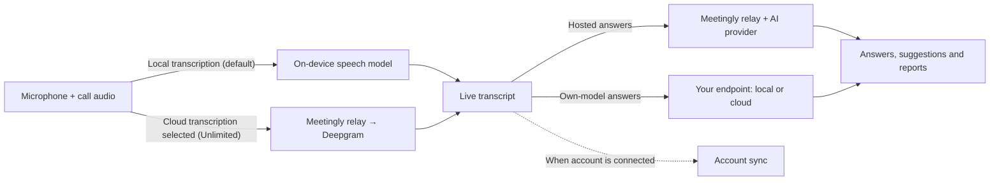

<p align="center"><b>Sponsored by <a href="https://aiprimetech.io">AI Prime Tech</a></b>: 低価格の Claude API と Codex API を利用できる AI API ゲートウェイ。Claude Code、Codex CLI、GPT モデルを 1 つのキーで使えます。</p>

<div align="center">


# Meetingly: オープンソースの AI 面接アシスタント兼ミーティング副操縦士

**相手がまだ質問している間に、答えを。**

Meetingly は、Windows、macOS、Linux で使える、就職面接とライブ会議向けの無料オープンソース AI アシスタントです。Zoom、Google Meet、Microsoft Teams などの通話を聞き取り、自分のコンピューター上で文字起こしし、質問された瞬間に画面へ回答を表示します。無料プラン（1 日 50 回回答、カード不要）を使うか、自分の OpenAI、OpenRouter、Ollama キーを持ち込めます。Cluely、Interview Coder、Final Round AI、LockedIn AI、Parakeet AI の無料代替です。

<p align="center"><!-- languages --><a href="README.md">English</a> · <a href="README.zh-CN.md">简体中文</a> · <a href="README.ru.md">Русский</a> · <a href="README.es.md">Español</a> · <a href="README.pt-BR.md">Português</a> · <b>日本語</b> · <a href="README.ko.md">한국어</a></p>

<a href="https://meetinglyai.com/download/Meetingly-Setup.exe"></a>
&nbsp;
<a href="https://meetinglyai.com/download/Meetingly-mac-arm64.dmg"></a>
&nbsp;
<a href="https://meetinglyai.com/download/Meetingly-linux.AppImage"></a>

<sub>その他: <a href="https://meetinglyai.com/download/Meetingly-mac-x64.dmg">Intel Mac</a> · <a href="https://meetinglyai.com/download/Meetingly-linux.deb">Debian / Ubuntu (.deb)</a> · <a href="https://meetinglyai.com/download/Meetingly.exe">Windows portable</a> · <a href="https://meetinglyai.com">meetinglyai.com</a></sub>


</div>

## 実用ガイド

[はじめに](https://meetinglyai.com/blog/ai-meeting-assistant-without-bot/) · [ローカルとクラウドのデータフロー](https://meetinglyai.com/blog/local-vs-cloud-transcription/) · [Ollama のセットアップ](https://meetinglyai.com/blog/meetingly-ollama-setup/) · [議事録テンプレート](https://meetinglyai.com/blog/meeting-notes-template/)

## 機能

- **本物の答えを、瞬時に。** 相手が何かを質問すると、すぐに答えが表示されます。口に出せる太字の1行と、広げるための要点がいくつか。コーチングでも、「…に触れるとよい」といった提案でもありません。
- **質問の提案。** サイド列が会話を追い、ワンクリックで使える質問を提示します。たった今聞かれた質問、出てきた用語、次に来そうな質問です。
- **自分のコンピューター上で音声認識。** デフォルトでは NVIDIA Nemotron が 28 言語をローカルで文字起こしします。Unlimited では、音声を Deepgram に送る任意のクラウド文字起こしも利用できます。
- **自分と相手を分けて表示。** 自分のマイクと通話音声を別々に文字起こしするので、チャットのように読めます。
- **画面分析。** ワンクリックで画面上の内容（コーディング課題、スライド、質問）を読み取り、回答します。
- **画面共有コンテンツの保護。** Windows と macOS では OS の保護機能を使います。一部のキャプチャ方法ではウィンドウが含まれる場合があります。Linux には同等の保護はありません。
- **会議レポート。** 各会議の終了時に、要約、決定事項、アクション項目、フォローアップを作成します。
- **自分の API キーを使うか、こちらのキーは使わないか。** 無料プランを使うか、Meetingly を OpenAI、OpenRouter、ローカルの Ollama モデル、または任意の OpenAI 互換エンドポイントに向けられます。
- Windows、macOS、Linux で **自動更新** します。通話中には更新しません。

**対応:** Zoom、Google Meet、Microsoft Teams、Slack ハドル、Discord、Webex など、コンピューター上で通話音声を再生するあらゆるアプリ。ボットは会議に参加しません。Meetingly はコンピューターの音声を聞き取ります。

## 主な用途

- **就職面接。** 一度 *Instructions* に貼り付けた履歴書と求人票をもとに、行動面接、技術面接、HR の質問に回答します。
- **コーディング面接。** 画面分析が画面上の課題（LeetCode、HackerRank、CoderPad、Codility、または共有エディタ）を読み取り、方針とコードで回答します。
- **営業・顧客対応の通話。** 顧客が話している最中に質問への回答を出し、終了後に次のステップを含むレポートを作成します。
- **会議・講義。** 28 言語のライブ文字起こし、質問候補、決定事項とアクション項目を含む要約を提供します。

## 2つの使い方

**無料アカウント。** パネルで *Sign up free* をクリックすると、カード不要で1日50件の AI 回答を使えます。指示（履歴書、求人内容）、設定、会議レポートは [web dashboard](https://account.meetinglyai.com) に保存され、すべてのコンピューターに同期されます。

| | Free | Pro | Unlimited |
|---|---|---|---|
| 料金 | $0 | $19.99 / 月、7日間無料 | $39.99 / 月 |
| 回答 | 1日50件 | 1日300件 | Unlimited（フェアユース） |
| 画面分析 | 1日3件 | 1日50件 | 1日300件 |
| ライブ提案 | 1日約30分 | 1日約4時間 | 1日約8時間 |
| 会議レポート | 1日1件 | 1日20件 | 1日100件 |
| コンピューター | 1 | 2 | 3 |

[plan page](https://account.meetinglyai.com/dashboard/plan) で、カード、SBP、または暗号資産で支払えます。Meetingly について投稿すると Pro が無料になります。詳しくは [creator reward](https://meetinglyai.com/creators/) をご覧ください。

**自分のキーを使い、アカウント不要。** Meetingly メニュー（時計の横にあるトレイアイコン）を開き、*Use your own API key…* を選び、プロバイダーを選択してキーを貼り付け、モデルを選びます。回答は自分のコンピューターからそのプロバイダーへ直接送られます。Meetingly のサーバーは一切経由せず、制限はプロバイダー側のものだけです。

| プロバイダー | API アドレス | キー |
|---|---|---|
| OpenAI | `https://api.openai.com/v1` | platform.openai.com から |
| OpenRouter | `https://openrouter.ai/api/v1` | openrouter.ai から |
| Ollama（完全ローカル） | `http://localhost:11434/v1` | なし |
| OpenAI 互換のもの（LM Studio、vLLM、LiteLLM…） | その `/v1` アドレス | 必要な場合 |

バージョン 1.2.3 では、API キーを保存する前に安全な OS キーチェーンが必要です。安全なストレージが利用可能になると既存の平文キーは移行されます。キーチェーンが利用できなくても保存済み設定は消去されません。画面分析には画像を受け付けるモデルが必要です。

## Meetingly vs Cluely、Pluely、Interview Coder、Final Round AI、LockedIn AI、Parakeet AI

| | **Meetingly** | Cluely | Pluely | Interview Coder | Final Round AI | LockedIn AI | Parakeet AI |
|---|---|---|---|---|---|---|---|
| 価格 | **Free**, Pro $19.99, Unlimited $39.99 / 月 | 無料プラン、Pro $19.99 / 月 | 自分のキーで無料、Pro は $15 / 月から、買い切り $120 | $299 / 月または買い切り $799 | Pro は $25 / 月から | $54.99 / 月、または 3 か月ごとの請求で $39.99 / 月 | €129.90 / 月、またはクレジット |
| 自分のキーなしでの無料 AI 回答 | **毎日 50 回** | "Limited AI responses" | — | なし: AI にはサブスクリプションが必要 | なし: ライブセッションには Pro が必要 | — | 10 分セッション 1 回 |
| 画面共有から非表示 | **全プラン。OS とキャプチャ方法の制限あり** | Pro + Undetectability のみ、$149.99 / 月 | 全プラン | 全プラン | Pro | — | 有料プラン |
| Linux | **AppImage and .deb** | — | .deb | — | — | — | Chrome のみ |
| オープンソース | **Apache-2.0** | — | GPL-3.0 | — | — | — | — |
| 自分の API キーを使用 | **OpenAI, OpenRouter, Ollama…** | — | はい | — | — | — | — |
| 自分のコンピューター上で音声認識 | **はい、28 言語** | — | — | — | — | — | — |

<sub>各製品の公式サイト（<a href="https://cluely.com/pricing">cluely.com/pricing</a>, <a href="https://pluely.com/pricing">pluely.com/pricing</a>, <a href="https://www.interviewcoder.co">interviewcoder.co</a>, <a href="https://www.finalroundai.com/pricing">finalroundai.com/pricing</a>, <a href="https://www.lockedinai.com/pricing">lockedinai.com/pricing</a>, <a href="https://www.parakeet-ai.com/pricing">parakeet-ai.com/pricing</a>）より、2026 年 10 月 5〜11 日。— は記載がないことを意味します。</sub>

<div align="center">

</div>

## 仕組み



ローカル文字起こしを選択した場合、音声は自分のコンピューター上で処理されます。Unlimited でクラウド文字起こしを選ぶと、音声はリレー経由で Deepgram に送られます。AI 回答は、関連する文字起こしテキスト、質問、要求されたスクリーンショットを使用します。ホストされたリレー/プロバイダー経由、または自分のエンドポイントへ直接送信されます。連携アカウントの同期は別のデータ経路です。

## インストール時の注意

インストーラーはまだコード署名されていないため、初回起動時に一度だけ確認が表示されます。

- **Windows:** SmartScreen でアプリが認識されないと表示されます。*More info* をクリックし、次に *Run anyway* をクリックしてください。
- **macOS:** システム設定 → プライバシーとセキュリティを開き、*Open Anyway* をクリックしてください。自動更新できるよう、アプリは Applications に置いてください。
- **Linux:** `chmod +x Meetingly-linux.AppImage` を実行して起動するか、.deb をインストールしてください。

## 開発

```bash
cd app
npm install
npm run fetch:asr   # speech engine for your platform
npm run dev
```

| コマンド | 内容 |
|---|---|
| `npm run dev` | ホットリロード付きで実行 |
| `npm test` | ユニットテスト |
| `npm run typecheck` | メインとレンダラーの型チェック |
| `npm run smoke` | すべてのウィンドウをヘッドレスで開き、レンダラーエラーで失敗（`node scripts/smoke.mjs ownkey` は own-key フローをテスト） |
| `npm run dist:win` | Windows インストーラーをビルド（macOS と Linux は GitHub Actions でビルド） |

```
app/      desktop app: Electron 44, React 19, Vite 8, TypeScript, Tailwind
relay/    the small Node service behind the Free, Pro and Unlimited plans (holds the API keys, picks the model per task)
docs/     images for this page
```

## FAQ

### Meetingly は無料ですか？

はい。無料プランでは、カード不要で 1 台のコンピューターにつき 1 日 50 回の AI 回答を利用できます。自分の API キーを使う場合、Meetingly 側の制限は一切ありません。コードは Apache-2.0 のもとでオープンソースです。

### Meetingly は Cluely の代替ですか？

はい。同じこと（通話中にオーバーレイでライブ回答）を行い、オープンソースで、Linux でも動作し、無料プランでも画面共有から非表示にでき、自分の API キーやローカルモデルで使えます。

### Zoom、Google Meet、Microsoft Teams で動作しますか？

はい。他の通話アプリでも動作します。Meetingly はコンピューターの音声をキャプチャするため（Windows ではループバック、macOS 13 以降ではオーディオタップ、Linux では PulseAudio モニターデバイス）、会議に何も参加せず、相手側にボットは見えません。

### 画面共有から非表示になりますか？検出不能ですか？

Windows と macOS では、ウィンドウは OS の画面キャプチャ保護を使用するため、通常は画面共有や録画に含まれません。一部のキャプチャ方法では含まれる場合があり、Linux にはそのような保護はありません。また、Meetingly は監督ソフトウェアを回避する目的で作られていません。どんなツールも、正直に検出不能を約束することはできません。

### コーディング面接に役立ちますか？

はい。画面分析は押したときだけスクリーンショットを撮り、課題（LeetCode、HackerRank、CoderPad、Codility、または任意のエディタ）を読み取り、方針とコードで回答します。自分のキーを使う場合は、画像を受け付けるモデルを選んでください。

### 完全にオフラインで動作しますか？

音声認識はすでに自分のコンピューター上で動作します。NVIDIA Nemotron を一度ダウンロードします（約 560 MB）。回答先をローカルの Ollama モデルにすれば、何もコンピューターの外に出ません。

### どの言語に対応していますか？

文字起こしと回答の両方で 28 言語に対応しています: 英語、アラビア語、ブルガリア語、中国語、クロアチア語、チェコ語、デンマーク語、オランダ語、エストニア語、フィンランド語、フランス語、ドイツ語、ヒンディー語、ハンガリー語、イタリア語、日本語、韓国語、ノルウェー語、ポーランド語、ポルトガル語、ルーマニア語、ロシア語、スロバキア語、スペイン語、スウェーデン語、トルコ語、ウクライナ語、ベトナム語。

### データはどこに保存されますか？

文字起こしとレポートはあなたのコンピューターに保存されます。無料アカウントでは、Instructions、設定、会議レポートも他のコンピューターに同期されます。音声は保存されません。詳細: [プライバシーポリシー](https://meetinglyai.com/privacy)。

## コントリビュート

コントリビューションを歓迎します。[CONTRIBUTING](.github/CONTRIBUTING.md) を参照してください。セキュリティの問題: [SECURITY](.github/SECURITY.md)。

Meetingly が役に立ったら、⭐ で他の人が見つけやすくなります。

## スポンサー

Meetinglyの無料プランは、Claude、Codex、GPTモデル向けのAI APIゲートウェイである**[AI Prime Tech](https://aiprimetech.io)**上で動作します。1つのキーで安価にClaude APIとCodex APIへアクセスでき、プリペイドまたは時間制プランを選べ、Claude CodeとCodex CLIのセットアップガイドも用意されています。

<div align="center">
<sub>Apache-2.0 ライセンス。</sub>
</div>
