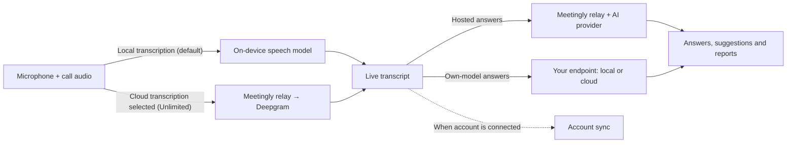

<p align="center"><b><a href="https://aiprimetech.io">AI Prime Tech</a> 후원</b>: 저렴한 Claude API 및 Codex API 액세스를 제공하는 AI API 게이트웨이. 하나의 키로 Claude Code, Codex CLI, GPT 모델을 사용하세요.</p>

<div align="center">


# Meetingly: 오픈 소스 AI 면접 도우미 및 회의 코파일럿

**질문이 끝나기도 전에 답을.**

Meetingly는 Windows, macOS, Linux에서 채용 면접과 실시간 회의에 사용할 수 있는 무료 오픈 소스 AI 도우미입니다. Zoom, Google Meet, Microsoft Teams 또는 다른 통화를 듣고, 내 컴퓨터에서 전사한 뒤 질문이 나오면 즉시 화면에 답을 표시합니다. 무료 플랜(하루 50개 답변, 카드 불필요)을 사용하거나, 직접 OpenAI, OpenRouter 또는 Ollama 키를 가져오세요. Cluely, Interview Coder, Final Round AI, LockedIn AI, Parakeet AI의 무료 대안입니다.

<p align="center"><!-- languages --><a href="README.md">English</a> · <a href="README.zh-CN.md">简体中文</a> · <a href="README.ru.md">Русский</a> · <a href="README.es.md">Español</a> · <a href="README.pt-BR.md">Português</a> · <a href="README.ja.md">日本語</a> · <b>한국어</b></p>

<a href="https://meetinglyai.com/download/Meetingly-Setup.exe"></a>
&nbsp;
<a href="https://meetinglyai.com/download/Meetingly-mac-arm64.dmg"></a>
&nbsp;
<a href="https://meetinglyai.com/download/Meetingly-linux.AppImage"></a>

<sub>추가: <a href="https://meetinglyai.com/download/Meetingly-mac-x64.dmg">Intel Mac</a> · <a href="https://meetinglyai.com/download/Meetingly-linux.deb">Debian / Ubuntu (.deb)</a> · <a href="https://meetinglyai.com/download/Meetingly.exe">Windows portable</a> · <a href="https://meetinglyai.com">meetinglyai.com</a></sub>


</div>

## 실용 가이드

[시작하기](https://meetinglyai.com/blog/ai-meeting-assistant-without-bot/) · [로컬 및 클라우드 데이터 흐름](https://meetinglyai.com/blog/local-vs-cloud-transcription/) · [Ollama 설정](https://meetinglyai.com/blog/meetingly-ollama-setup/) · [회의록 템플릿](https://meetinglyai.com/blog/meeting-notes-template/)

## 기능

- **진짜 답변을 즉시.** 상대방이 질문하면 *Answer*를 누르세요(Pro의 자동 답변에 맡겨도 됩니다): 말할 수 있는 굵은 한 줄과, 자세히 설명할 수 있는 몇 가지 핵심 포인트가 제공됩니다. 코칭도, "…을 언급해도 됩니다" 같은 말도 없습니다.
- **추천 질문.** 사이드 컬럼이 대화를 따라가며 한 번 클릭으로 쓸 수 있는 질문을 제공합니다. 방금 받은 질문, 나온 용어, 다음에 나올 가능성이 큰 질문입니다.
- **내 컴퓨터에서 음성 인식.** NVIDIA Nemotron이 기본적으로 28개 언어를 로컬에서 전사합니다. Unlimited는 오디오를 Deepgram으로 보내는 선택적 클라우드 전사도 제공합니다.
- **나와 상대를 분리.** 내 마이크와 통화 오디오를 따로 텍스트로 변환해, 기록이 채팅처럼 읽힙니다.
- **화면 분석.** 한 번 클릭으로 화면의 내용(코딩 과제, 슬라이드, 질문)을 읽고 답합니다.
- **화면 공유 콘텐츠 보호.** Windows와 macOS의 OS 보호 기능을 사용합니다. 일부 캡처 방식에서는 여전히 창이 포함될 수 있으며, Linux는 동일한 보호 기능을 제공하지 않습니다.
- **회의 보고서.** 모든 회의가 요약, 결정 사항, 액션 아이템, 후속 조치로 마무리됩니다.
- **텍스트 파일로 저장되는 대화록.** 모든 세션은 매 발화마다 You와 Them이 표시된 일반 .txt 파일로 *Documents/Meetingly*에 저장됩니다. 따라서 Meetingly는 AI와 계정 없이도 무료 받아쓰기 앱으로 사용할 수 있습니다.
- **내 API 키를 쓰거나, 우리 키를 쓰지 않거나.** 무료 플랜을 사용하거나 Meetingly를 OpenAI, OpenRouter, 로컬 Ollama 모델 또는 OpenAI 호환 엔드포인트에 연결하세요.
- Windows, macOS, Linux에서 **자동 업데이트**되며, 통화 중에는 절대 업데이트하지 않습니다.

**지원 앱:** Zoom, Google Meet, Microsoft Teams, Slack 허들, Discord, Webex 및 컴퓨터에서 통화를 재생하는 모든 앱. 봇은 회의에 참여하지 않습니다. Meetingly는 컴퓨터의 오디오를 듣습니다.

## 주요 사용 사례

- **채용 면접.** 이력서와 채용 공고를 *Instructions*에 한 번 붙여 넣으면 행동, 기술, HR 질문에 답합니다.
- **코딩 면접.** 화면 분석이 화면의 과제(LeetCode, HackerRank, CoderPad, Codility 또는 공유 편집기)를 읽고 접근 방식과 코드로 답합니다.
- **영업 및 고객 통화.** 고객이 아직 말하는 중에도 질문에 대한 답을 제공하고, 이후 다음 단계가 포함된 보고서를 제공합니다.
- **회의 및 강의.** 28개 언어의 실시간 전사, 추천 질문, 결정 사항과 액션 아이템이 포함된 요약을 제공합니다.

## 사용하는 두 가지 방법

**무료 계정.** 패널에서 *Sign up free*를 클릭하세요. 카드 없이 하루 50개의 AI 답변을 제공합니다. 지침(이력서, 직무 설명), 설정, 회의 보고서는 [웹 대시보드](https://account.meetinglyai.com)에 저장되고 모든 컴퓨터와 동기화됩니다.

| | 무료 | Lite | Pro | Unlimited |
|---|---|---|---|---|
| 가격 | $0 | 월 $9.99, 7일 무료 | 월 $19.99 | 월 $39.99 |
| 답변 | 하루 50개 | 하루 150개 | 하루 300개 | 무제한(공정 사용) |
| 자동 답변(질문이 들어오는 즉시 답변) | —(Answer 누르기) | 포함 | 포함 | 포함 |
| 화면 분석 | 하루 3회 | 하루 15회 | 하루 50회 | 하루 300회 |
| 실시간 제안 | 하루 약 30분 | 하루 약 2시간 | 하루 약 4시간 | 하루 약 8시간 |
| 회의 보고서 | 하루 1개 | 하루 5개 | 하루 20개 | 하루 100개 |
| 컴퓨터 | 1 | 1 | 2 | 3 |

[플랜 페이지](https://account.meetinglyai.com/dashboard/plan)에서 카드, SBP 또는 암호화폐로 결제하세요. Meetingly에 대해 게시하고 Pro를 무료로 받으세요. [크리에이터 보상](https://meetinglyai.com/creators/)을 확인하세요.

**내 키로, 계정 없이.** Meetingly 메뉴(시계 옆 트레이 아이콘)를 열고 *Use your own API key…*를 선택한 뒤, 제공업체를 고르고 키를 붙여넣고 모델을 선택하세요. 답변은 내 컴퓨터에서 해당 제공업체로 바로 전송됩니다. Meetingly 서버를 거치지 않으며, 제한은 제공업체의 제한뿐입니다.

| 제공업체 | API 주소 | 키 |
|---|---|---|
| OpenAI | `https://api.openai.com/v1` | platform.openai.com에서 |
| OpenRouter | `https://openrouter.ai/api/v1` | openrouter.ai에서 |
| Ollama (완전 로컬) | `http://localhost:11434/v1` | 없음 |
| OpenAI 호환 항목(LM Studio, vLLM, LiteLLM…) | 해당 `/v1` 주소 | 필요한 경우 |

버전 1.2.3은 API 키를 저장하기 전에 안전한 OS 키체인이 필요합니다. 기존 평문 키는 보안 저장소를 사용할 수 있을 때 마이그레이션되며, 키체인을 사용할 수 없어도 저장된 설정은 지워지지 않습니다. 화면 분석에는 이미지를 받을 수 있는 모델이 필요합니다.

## Meetingly vs Cluely, Pluely, Interview Coder, Final Round AI, LockedIn AI, Parakeet AI

| | **Meetingly** | Cluely | Pluely | Interview Coder | Final Round AI | LockedIn AI | Parakeet AI |
|---|---|---|---|---|---|---|---|
| 요금 | **무료**, Lite $9.99, Pro $19.99, Unlimited 월 $39.99 | 무료 요금제, Pro 월 $19.99 | 자체 키 사용 시 무료, Pro 월 $15부터, 평생 이용 $120 | 월 $299 또는 평생 이용 $799 | Pro 월 $25부터 | 월 $54.99 또는 3개월마다 청구 시 월 $39.99 | 월 €129.90 또는 크레딧 |
| 직접 키 없이 무료 AI 답변 | **매일 하루 50개** | "Limited AI responses" | — | 없음: AI에는 구독 필요 | 없음: 라이브 세션에는 Pro 필요 | — | 10분 세션 1회 |
| 화면 공유에서 숨김 | **모든 플랜; OS 및 캡처 방식 제한 적용** | Pro + Undetectability만, $149.99 / 월 | 모든 플랜 | 모든 플랜 | Pro | — | 유료 플랜 |
| Linux | **AppImage 및 .deb** | — | .deb | — | — | — | Chrome에서만 |
| 오픈 소스 | **Apache-2.0** | — | GPL-3.0 | — | — | — | — |
| 직접 API 키 사용 | **OpenAI, OpenRouter, Ollama…** | — | 예 | — | — | — | — |
| 내 컴퓨터에서 음성 인식 | **예, 28개 언어** | — | — | — | — | — | — |

<sub>각 제품의 공식 사이트 기준(<a href="https://cluely.com/pricing">cluely.com/pricing</a>, <a href="https://pluely.com/pricing">pluely.com/pricing</a>, <a href="https://www.interviewcoder.co">interviewcoder.co</a>, <a href="https://www.finalroundai.com/pricing">finalroundai.com/pricing</a>, <a href="https://www.lockedinai.com/pricing">lockedinai.com/pricing</a>, <a href="https://www.parakeet-ai.com/pricing">parakeet-ai.com/pricing</a>), 2026년 10월 5–11일. —는 해당 사이트에 언급이 없음을 의미합니다.</sub>

<div align="center">

</div>

## 작동 방식



로컬 전사를 선택하면 오디오는 내 컴퓨터에서 처리됩니다. Unlimited에서 클라우드 전사를 선택하면 오디오가 릴레이를 통해 Deepgram으로 전송됩니다. AI 답변은 관련 전사 텍스트, 질문, 요청된 스크린샷을 사용합니다. 호스팅 릴레이/제공자를 통하거나, 직접 설정한 엔드포인트를 통해 처리됩니다. 연결된 계정 동기화는 별도의 데이터 경로입니다.

## 설치 참고 사항

설치 프로그램은 아직 코드 서명되지 않았으므로 첫 실행 시 한 번 확인을 요청합니다.

- **Windows:** SmartScreen에서 앱을 인식할 수 없다고 표시됩니다. *More info*를 클릭한 다음 *Run anyway*를 클릭하세요.
- **macOS:** System Settings → Privacy & Security를 열고 *Open Anyway*를 클릭하세요. 앱이 자동 업데이트될 수 있도록 Applications에 보관하세요.
- **Linux:** `chmod +x Meetingly-linux.AppImage`를 실행한 뒤 실행하거나 .deb를 설치하세요.

## 개발

```bash
cd app
npm install
npm run fetch:asr   # speech engine for your platform
npm run dev
```

| 명령어 | 설명 |
|---|---|
| `npm run dev` | 핫 리로드로 실행 |
| `npm test` | 단위 테스트 |
| `npm run typecheck` | main과 renderer 타입 검사 |
| `npm run smoke` | 모든 창을 헤드리스로 열고 renderer 오류가 있으면 실패 처리(`node scripts/smoke.mjs ownkey`는 자체 키 흐름을 테스트) |
| `npm run dist:win` | Windows 설치 프로그램 빌드(macOS 및 Linux 빌드는 GitHub Actions에서 수행) |

```
app/      desktop app: Electron 44, React 19, Vite 8, TypeScript, Tailwind
relay/    the small Node service behind the Free, Pro and Unlimited plans (holds the API keys, picks the model per task)
docs/     images for this page
```

## FAQ

### Meetingly는 무료인가요?

예. 무료 플랜은 카드 없이 컴퓨터 1대에서 하루 50개의 AI 답변을 제공합니다. 직접 API 키를 사용하면 Meetingly 제한이 전혀 없습니다. 코드는 Apache-2.0으로 오픈 소스입니다.

### Meetingly는 Cluely의 대안인가요?

예. 같은 역할(통화 중 오버레이로 실시간 답변)을 하며, 오픈 소스이고 Linux에서도 실행되며, 무료 플랜에서도 화면 공유에서 숨겨지고, 직접 API 키나 로컬 모델과 함께 작동합니다.

### Zoom, Google Meet, Microsoft Teams에서 작동하나요?

예, 다른 모든 통화 앱에서도 작동합니다. Meetingly는 컴퓨터의 오디오(Windows의 루프백, macOS 13 이상에서 오디오 탭, Linux의 PulseAudio 모니터 장치)를 캡처하므로, 회의에 아무것도 참여하지 않고 상대방에게 봇이 보이지 않습니다.

### 화면 공유에서 숨겨지나요? 감지 불가능한가요?

Windows와 macOS에서는 창이 운영 체제의 화면 캡처 보호를 사용하므로, 일반적으로 화면 공유와 녹화에 포함되지 않습니다. 일부 캡처 방식에서는 여전히 포함될 수 있고, Linux에는 그런 보호 기능이 없으며, Meetingly는 감독 소프트웨어를 우회하도록 만들어지지 않았습니다. 어떤 도구도 감지 불가능하다고 정직하게 약속할 수는 없습니다.

### 코딩 면접에 도움이 되나요?

예. 화면 분석은 버튼을 누를 때만 스크린샷을 찍고, 과제(LeetCode, HackerRank, CoderPad, Codility 또는 모든 편집기)를 읽은 뒤 접근 방식과 코드로 답합니다. 직접 키를 사용할 때는 이미지를 받을 수 있는 모델을 선택하세요.

### AI 없이 받아쓰기만 사용할 수 있나요?

네. Listen을 누르면 Meetingly가 컴퓨터에서 통화를 28개 언어로 시간 제한 없이 받아쓰고, 각 세션을 *Documents/Meetingly*에 .txt 파일로 저장합니다. 실시간 제안과 자동 답변은 처음에 꺼져 있으며, 자동으로 실행되는 유일한 AI 기능은 회의 종료 시 생성되는 보고서입니다.

### 완전히 오프라인으로 실행할 수 있나요?

음성 인식은 이미 내 컴퓨터에서 실행됩니다. NVIDIA Nemotron을 한 번 다운로드합니다(약 560 MB). 답변을 로컬 Ollama 모델로 지정하면 아무것도 컴퓨터 밖으로 나가지 않습니다.

### 어떤 언어를 지원하나요?

전사와 답변 모두 28개 언어를 지원합니다: 영어, 아랍어, 불가리아어, 중국어, 크로아티아어, 체코어, 덴마크어, 네덜란드어, 에스토니아어, 핀란드어, 프랑스어, 독일어, 힌디어, 헝가리어, 이탈리아어, 일본어, 한국어, 노르웨이어, 폴란드어, 포르투갈어, 루마니아어, 러시아어, 슬로바키아어, 스페인어, 스웨덴어, 터키어, 우크라이나어, 베트남어.

### 내 데이터는 어디에 저장되나요?

전사와 보고서는 컴퓨터에 저장됩니다. 무료 계정을 사용하면 Instructions, 설정, 회의 보고서도 다른 컴퓨터와 동기화됩니다. 오디오는 저장되지 않습니다. 자세한 내용: [개인정보 처리방침](https://meetinglyai.com/privacy).

## 기여하기

기여를 환영합니다. [CONTRIBUTING](.github/CONTRIBUTING.md)을 참고하세요. 보안 문제는 [SECURITY](.github/SECURITY.md)를 확인하세요.

Meetingly가 도움이 되었다면 ⭐로 다른 사람들이 찾을 수 있게 도와주세요.

## 스폰서

Meetingly의 무료 플랜은 Claude, Codex, GPT 모델을 위한 AI API 게이트웨이인 **[AI Prime Tech](https://aiprimetech.io)**에서 실행됩니다. 하나의 키로 저렴한 Claude API와 Codex API에 접근할 수 있으며, 선불 또는 시간제 플랜을 제공하고 Claude Code와 Codex CLI 설정 가이드도 포함되어 있습니다.

<div align="center">
<sub>Apache-2.0 라이선스.</sub>
</div>
