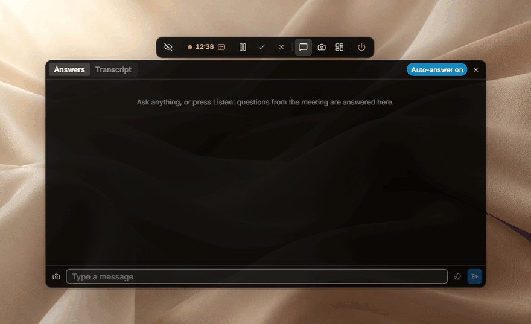
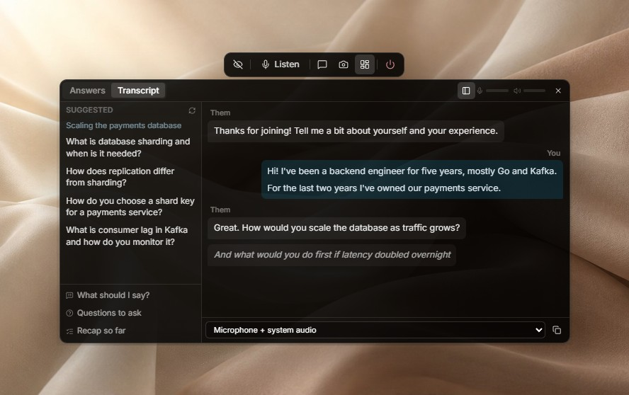
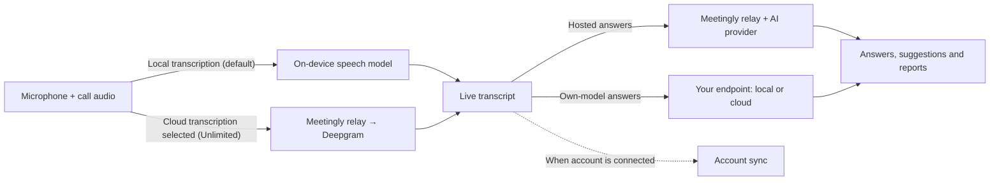

<p align="center"><b>Sponsored by <a href="https://aiprimetech.io">AI Prime Tech</a></b>: an AI API gateway with cheap Claude API and Codex API access. One key for Claude Code, Codex CLI and GPT models.</p>

<div align="center">


# Meetingly: open-source AI interview assistant and meeting copilot

**The answer, while they're still asking.**

Meetingly is a free, open-source AI assistant for job interviews and live meetings on Windows, macOS and Linux. It listens to Zoom, Google Meet, Microsoft Teams or any other call, transcribes it on your own computer and puts the answer on screen the moment a question is asked. Use the free plan (50 answers a day, no card), or bring your own OpenAI, OpenRouter or Ollama key. A free alternative to Cluely, Interview Coder, Final Round AI, LockedIn AI and Parakeet AI.

<p align="center"><!-- languages --><b>English</b> · <a href="README.zh-CN.md">简体中文</a> · <a href="README.ru.md">Русский</a> · <a href="README.es.md">Español</a> · <a href="README.pt-BR.md">Português</a> · <a href="README.ja.md">日本語</a> · <a href="README.ko.md">한국어</a></p>

<a href="https://meetinglyai.com/download/Meetingly-Setup.exe"></a>
&nbsp;
<a href="https://meetinglyai.com/download/Meetingly-mac-arm64.dmg"></a>
&nbsp;
<a href="https://meetinglyai.com/download/Meetingly-linux.AppImage"></a>

<sub>Also: <a href="https://meetinglyai.com/download/Meetingly-mac-x64.dmg">Intel Mac</a> · <a href="https://meetinglyai.com/download/Meetingly-linux.deb">Debian / Ubuntu (.deb)</a> · <a href="https://meetinglyai.com/download/Meetingly.exe">Windows portable</a> · <a href="https://meetinglyai.com">meetinglyai.com</a></sub>




</div>

## Practical guides

[Get started](https://meetinglyai.com/blog/ai-meeting-assistant-without-bot/) · [Local and cloud data flows](https://meetinglyai.com/blog/local-vs-cloud-transcription/) · [Ollama setup](https://meetinglyai.com/blog/meetingly-ollama-setup/) · [Meeting notes template](https://meetinglyai.com/blog/meeting-notes-template/)

## Features

- **Real answers, instantly.** When the other side asks something, press *Answer* (or let Pro's auto-answer do it): one bold line you can say, then a few catch points to expand on. No coaching, no "you could mention…".
- **Suggested questions.** A side column follows the conversation and offers one-click questions: the question you were just asked, terms that came up, the likely next question.
- **Speech recognition on your computer.** NVIDIA Nemotron transcribes locally in 28 languages by default. Unlimited also offers optional cloud transcription, which sends audio to Deepgram.
- **You and Them, separated.** Your microphone and the call audio are transcribed apart, so the transcript reads like a chat.
- **Screen analysis.** One click reads what is on your screen (a coding task, a slide, a question) and answers it.
- **Screen-share content protection.** Uses OS protection on Windows and macOS. Some capture methods can still include the window; Linux does not offer the same protection.
- **Meeting reports.** Every meeting ends with a summary, decisions, action items and follow-ups.
- **Transcripts saved as text files.** Every session is saved to *Documents/Meetingly* as a plain .txt with You and Them on each turn, so Meetingly also works as a free transcription app, with no AI and no account.
- **Your own API key, or none of ours.** Use the free plan, or point Meetingly at OpenAI, OpenRouter, a local Ollama model or any OpenAI-compatible endpoint.
- **Updates itself** on Windows, macOS and Linux, never in the middle of a call.

**Works with** Zoom, Google Meet, Microsoft Teams, Slack huddles, Discord, Webex and any other app that plays the call on your computer. No bot joins the meeting: Meetingly listens to your computer's audio.

## What people use it for

- **Job interviews.** Behavioral, technical and HR questions answered from your CV and the job description, which you paste once into *Instructions*.
- **Coding interviews.** Screen analysis reads the task on screen (LeetCode, HackerRank, CoderPad, Codility or a shared editor) and answers with an approach and code.
- **Sales and client calls.** The answer to a customer's question while they are still talking, and a report with next steps afterwards.
- **Meetings and lectures.** A live transcript in 28 languages, suggested questions, and a summary with decisions and action items.

## Two ways to use it

**Free account.** Click *Sign up free* in the panel: 50 AI answers a day, no card. Instructions (your CV, the job description), settings and meeting reports live in your [web dashboard](https://account.meetinglyai.com) and sync to every computer.

| | Free | Lite | Pro | Unlimited |
|---|---|---|---|---|
| Price | $0 | $9.99 / month | $19.99 / month, 7 days free | $39.99 / month |
| Answers | 50 a day | 150 a day | 300 a day | Unlimited (fair use) |
| Auto-answer (answers questions as they're asked) | — (press Answer) | Included | Included | Included |
| Screen analysis | 3 a day | 15 a day | 50 a day | 300 a day |
| Live suggestions | About 30 minutes a day | About 2 hours a day | About 4 hours a day | About 8 hours a day |
| Meeting reports | 1 a day | 5 a day | 20 a day | 100 a day |
| Computers | 1 | 1 | 2 | 3 |

Pay by card, or with SBP or crypto, on the [plan page](https://account.meetinglyai.com/dashboard/plan). Post about Meetingly and get Pro free: see the [creator reward](https://meetinglyai.com/creators/).

**Your own key, no account.** Open the Meetingly menu (the tray icon next to the clock) and choose *Use your own API key…*, pick a provider, paste a key and choose a model. Answers go straight from your computer to that provider; nothing passes through Meetingly's servers, and there are no limits but your provider's.

| Provider | API address | Key |
|---|---|---|
| OpenAI | `https://api.openai.com/v1` | from platform.openai.com |
| OpenRouter | `https://openrouter.ai/api/v1` | from openrouter.ai |
| Ollama (fully local) | `http://localhost:11434/v1` | none |
| Anything OpenAI-compatible (LM Studio, vLLM, LiteLLM…) | its `/v1` address | if it needs one |

Version 1.2.3 requires a secure OS keychain before saving an API key. Existing plaintext keys migrate when secure storage is available; an unavailable keychain does not erase the saved setting. Screen analysis needs a model that accepts images.

## Meetingly vs Cluely, Pluely, Interview Coder, Final Round AI, LockedIn AI and Parakeet AI

| | **Meetingly** | Cluely | Pluely | Interview Coder | Final Round AI | LockedIn AI | Parakeet AI |
|---|---|---|---|---|---|---|---|
| Price | **Free**, Lite $9.99, Pro $19.99, Unlimited $39.99 / month | Free plan, Pro $19.99 / month | Free with your own keys, Pro from $15 / month, $120 lifetime | $299 / month or $799 lifetime | Pro from $25 / month | $54.99 / month, or $39.99 / month billed every 3 months | €129.90 / month, or credits |
| Free AI answers without your own key | **50 a day, every day** | "Limited AI responses" | — | None: AI needs a subscription | None: live sessions need Pro | — | One 10-minute session |
| Hidden from screen sharing | **Every plan; OS and capture-method limitations apply** | Only Pro + Undetectability, $149.99 / month | Every plan | Every plan | Pro | — | Paid plans |
| Linux | **AppImage and .deb** | — | .deb | — | — | — | In Chrome only |
| Open source | **Apache-2.0** | — | GPL-3.0 | — | — | — | — |
| Use your own API key | **OpenAI, OpenRouter, Ollama…** | — | Yes | — | — | — | — |
| Speech recognition on your computer | **Yes, 28 languages** | — | — | — | — | — | — |

<sub>From each product's own site (<a href="https://cluely.com/pricing">cluely.com/pricing</a>, <a href="https://pluely.com/pricing">pluely.com/pricing</a>, <a href="https://www.interviewcoder.co">interviewcoder.co</a>, <a href="https://www.finalroundai.com/pricing">finalroundai.com/pricing</a>, <a href="https://www.lockedinai.com/pricing">lockedinai.com/pricing</a>, <a href="https://www.parakeet-ai.com/pricing">parakeet-ai.com/pricing</a>), 5–11 October 2026. — means not mentioned there.</sub>

<div align="center">

</div>

## How it works



Audio is processed on your computer when local transcription is selected. Choosing cloud transcription on Unlimited sends audio through the relay to Deepgram. AI answers use the relevant transcript text, questions and requested screenshots: through the hosted relay/provider, or directly through your own endpoint. Connected-account synchronization is a separate data path.

## Install notes

The installers aren't code-signed yet, so the first launch asks once:

- **Windows:** SmartScreen says the app is unrecognized. Click *More info*, then *Run anyway*.
- **macOS:** open System Settings → Privacy & Security and click *Open Anyway*. Keep the app in Applications so it can update itself.
- **Linux:** `chmod +x Meetingly-linux.AppImage` and run it, or install the .deb.

## Development

```bash
cd app
npm install
npm run fetch:asr   # speech engine for your platform
npm run dev
```

| Command | What it does |
|---|---|
| `npm run dev` | Run with hot reload |
| `npm test` | Unit tests |
| `npm run typecheck` | Type-check main and renderer |
| `npm run smoke` | Open every window headless and fail on renderer errors (`node scripts/smoke.mjs ownkey` tests the own-key flow) |
| `npm run dist:win` | Build the Windows installer (macOS and Linux build in GitHub Actions) |

```
app/      desktop app: Electron 44, React 19, Vite 8, TypeScript, Tailwind
relay/    the small Node service behind the Free, Pro and Unlimited plans (holds the API keys, picks the model per task)
docs/     images for this page
```

## FAQ

### Is Meetingly free?

Yes. The free plan gives 50 AI answers a day with no card, on one computer. With your own API key there is no Meetingly limit at all. The code is open source under Apache-2.0.

### Is Meetingly a Cluely alternative?

Yes. It does the same job (live answers in an overlay during a call), and it is open source, runs on Linux too, hides from screen sharing on the free plan, and works with your own API key or a local model.

### Does it work with Zoom, Google Meet and Microsoft Teams?

Yes, and with any other call app. Meetingly captures your computer's audio (loopback on Windows, an audio tap on macOS 13 and later, PulseAudio monitor devices on Linux), so nothing joins the meeting and the other side sees no bot.

### Is it hidden from screen sharing? Is it undetectable?

On Windows and macOS the windows use the operating system's screen-capture protection, so screen shares and recordings normally leave them out. Some capture methods can still include them, Linux has no such protection, and Meetingly is not built to get around proctoring software. No tool can honestly promise to be undetectable.

### Can it help in coding interviews?

Yes. Screen analysis takes a screenshot only when you press it, reads the task (LeetCode, HackerRank, CoderPad, Codility or any editor) and answers with an approach and code. With your own key, choose a model that accepts images.

### Can I use it only for transcription, without AI?

Yes. Press Listen and Meetingly transcribes the call on your computer in 28 languages, with no time limit, and saves each session as a .txt file in *Documents/Meetingly*. Live suggestions and auto-answer start off; the only AI step that runs on its own is the report at the end of a meeting.

### Can it run fully offline?

Speech recognition already runs on your computer: NVIDIA Nemotron, downloaded once (about 560 MB). Point the answers at a local Ollama model and nothing leaves your computer.

### Which languages does it support?

28, for both transcription and answers: English, Arabic, Bulgarian, Chinese, Croatian, Czech, Danish, Dutch, Estonian, Finnish, French, German, Hindi, Hungarian, Italian, Japanese, Korean, Norwegian, Polish, Portuguese, Romanian, Russian, Slovak, Spanish, Swedish, Turkish, Ukrainian and Vietnamese.

### Where is my data stored?

Transcripts and reports are saved on your computer. With a free account, your instructions, settings and meeting reports also sync to your other computers. Audio is not stored. Details: [privacy policy](https://meetinglyai.com/privacy).

## Contributing

Contributions are welcome, see [CONTRIBUTING](.github/CONTRIBUTING.md). Security issues: [SECURITY](.github/SECURITY.md).

If Meetingly helps you, a ⭐ helps other people find it.

## Sponsor

Meetingly's free plan runs on **[AI Prime Tech](https://aiprimetech.io)**, an AI API gateway for Claude, Codex and GPT models: cheap Claude API and Codex API access with one key, prepaid or on a timed plan, with setup guides for Claude Code and Codex CLI.

<div align="center">
<sub>Apache-2.0 licensed.</sub>
</div>
