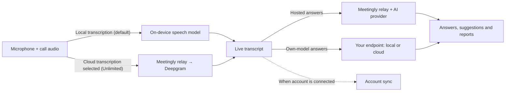

<p align="center"><b>Patrocinado por <a href="https://aiprimetech.io">AI Prime Tech</a></b>: um gateway de API de IA com acesso barato às APIs Claude e Codex. Uma chave para Claude Code, Codex CLI e modelos GPT.</p>

<div align="center">


# Meetingly: assistente de IA open-source para entrevistas e copiloto de reuniões

**A resposta, enquanto ainda estão perguntando.**

Meetingly é um assistente de IA gratuito e open-source para entrevistas de emprego e reuniões ao vivo no Windows, macOS e Linux. Ele escuta Zoom, Google Meet, Microsoft Teams ou qualquer outra chamada, transcreve no seu próprio computador e mostra a resposta na tela no momento em que uma pergunta é feita. Use o plano gratuito (50 respostas por dia, sem cartão) ou traga sua própria chave OpenAI, OpenRouter ou Ollama. Uma alternativa gratuita ao Cluely, Interview Coder, Final Round AI, LockedIn AI e Parakeet AI.

<p align="center"><!-- languages --><a href="README.md">English</a> · <a href="README.zh-CN.md">简体中文</a> · <a href="README.ru.md">Русский</a> · <a href="README.es.md">Español</a> · <b>Português</b> · <a href="README.ja.md">日本語</a> · <a href="README.ko.md">한국어</a></p>

<a href="https://meetinglyai.com/download/Meetingly-Setup.exe"></a>
&nbsp;
<a href="https://meetinglyai.com/download/Meetingly-mac-arm64.dmg"></a>
&nbsp;
<a href="https://meetinglyai.com/download/Meetingly-linux.AppImage"></a>

<sub>Também: <a href="https://meetinglyai.com/download/Meetingly-mac-x64.dmg">Intel Mac</a> · <a href="https://meetinglyai.com/download/Meetingly-linux.deb">Debian / Ubuntu (.deb)</a> · <a href="https://meetinglyai.com/download/Meetingly.exe">Windows portátil</a> · <a href="https://meetinglyai.com">meetinglyai.com</a></sub>


</div>

## Guias práticos

[Comece aqui](https://meetinglyai.com/blog/ai-meeting-assistant-without-bot/) · [Fluxos de dados locais e na nuvem](https://meetinglyai.com/blog/local-vs-cloud-transcription/) · [Configuração do Ollama](https://meetinglyai.com/blog/meetingly-ollama-setup/) · [Modelo de notas de reunião](https://meetinglyai.com/blog/meeting-notes-template/)

## Recursos

- **Respostas reais, instantâneas.** Quando a outra pessoa pergunta algo, a resposta aparece na hora: uma linha em negrito que você pode dizer, depois alguns pontos para desenvolver. Sem coaching, sem "você poderia mencionar…".
- **Perguntas sugeridas.** Uma coluna lateral acompanha a conversa e oferece perguntas com um clique: a pergunta que acabaram de fazer, termos que surgiram, a provável próxima pergunta.
- **Reconhecimento de fala no seu computador.** NVIDIA Nemotron transcreve localmente em 28 idiomas por padrão. Unlimited também oferece transcrição opcional na nuvem, que envia áudio para Deepgram.
- **Você e Eles, separados.** Seu microfone e o áudio da chamada são transcritos separadamente, então a transcrição parece um chat.
- **Análise de tela.** Um clique lê o que está na sua tela (uma tarefa de código, um slide, uma pergunta) e responde.
- **Proteção de conteúdo no compartilhamento de tela.** Usa a proteção do sistema operacional no Windows e macOS. Alguns métodos de captura ainda podem incluir a janela; Linux não oferece a mesma proteção.
- **Relatórios de reunião.** Toda reunião termina com um resumo, decisões, itens de ação e acompanhamentos.
- **Sua própria chave de API, ou nenhuma nossa.** Use o plano grátis, ou aponte o Meetingly para OpenAI, OpenRouter, um modelo Ollama local ou qualquer endpoint compatível com OpenAI.
- **Atualiza sozinho** no Windows, macOS e Linux, nunca no meio de uma chamada.

**Funciona com** Zoom, Google Meet, Microsoft Teams, huddles do Slack, Discord, Webex e qualquer outro app que reproduza a chamada no seu computador. Nenhum bot entra na reunião: Meetingly escuta o áudio do seu computador.

## Para que as pessoas usam

- **Entrevistas de emprego.** Perguntas comportamentais, técnicas e de RH respondidas com base no seu currículo e na descrição da vaga, que você cola uma vez em *Instructions*.
- **Entrevistas de programação.** A análise de tela lê a tarefa na tela (LeetCode, HackerRank, CoderPad, Codility ou um editor compartilhado) e responde com uma abordagem e código.
- **Vendas e chamadas com clientes.** A resposta para a pergunta de um cliente enquanto ele ainda está falando, e um relatório com próximos passos depois.
- **Reuniões e aulas.** Uma transcrição ao vivo em 28 idiomas, perguntas sugeridas e um resumo com decisões e itens de ação.

## Duas formas de usar

**Conta grátis.** Clique em *Sign up free* no painel: 50 respostas de AI por dia, sem cartão. Instruções (seu currículo, a descrição da vaga), configurações e relatórios de reunião ficam no seu [dashboard web](https://account.meetinglyai.com) e sincronizam com todos os computadores.

| | Free | Pro | Unlimited |
|---|---|---|---|
| Preço | $0 | $19.99 / mês, 7 dias grátis | $39.99 / mês |
| Respostas | 50 por dia | 300 por dia | Unlimited (uso justo) |
| Análise de tela | 3 por dia | 50 por dia | 300 por dia |
| Sugestões ao vivo | Cerca de 30 minutos por dia | Cerca de 4 horas por dia | Cerca de 8 horas por dia |
| Relatórios de reunião | 1 por dia | 20 por dia | 100 por dia |
| Computadores | 1 | 2 | 3 |

Pague com cartão, ou com SBP ou cripto, na [página de planos](https://account.meetinglyai.com/dashboard/plan). Publique sobre o Meetingly e ganhe Pro grátis: veja a [recompensa para criadores](https://meetinglyai.com/creators/).

**Sua própria chave, sem conta.** Abra o menu do Meetingly (o ícone na bandeja ao lado do relógio) e escolha *Use your own API key…*, selecione um provedor, cole uma chave e escolha um modelo. As respostas vão direto do seu computador para esse provedor; nada passa pelos servidores do Meetingly, e não há limites além dos do seu provedor.

| Provedor | Endereço da API | Chave |
|---|---|---|
| OpenAI | `https://api.openai.com/v1` | de platform.openai.com |
| OpenRouter | `https://openrouter.ai/api/v1` | de openrouter.ai |
| Ollama (totalmente local) | `http://localhost:11434/v1` | nenhuma |
| Qualquer coisa compatível com OpenAI (LM Studio, vLLM, LiteLLM…) | seu endereço `/v1` | se precisar de uma |

A versão 1.2.3 exige um chaveiro seguro do sistema operacional antes de salvar uma chave de API. Chaves existentes em texto simples migram quando o armazenamento seguro está disponível; um chaveiro indisponível não apaga a configuração salva. A análise de tela precisa de um modelo que aceite imagens.

## Meetingly vs Cluely, Pluely, Interview Coder, Final Round AI, LockedIn AI e Parakeet AI

| | **Meetingly** | Cluely | Pluely | Interview Coder | Final Round AI | LockedIn AI | Parakeet AI |
|---|---|---|---|---|---|---|---|
| Preço | **Grátis**, Pro US$ 19,99, Unlimited US$ 39,99 / mês | Plano gratuito, Pro US$ 19,99 / mês | Grátis com suas próprias chaves, Pro a partir de US$ 15 / mês, US$ 120 vitalício | US$ 299 / mês ou US$ 799 vitalício | Pro a partir de US$ 25 / mês | US$ 54,99 / mês, ou US$ 39,99 / mês cobrado a cada 3 meses | €129,90 / mês, ou créditos |
| Respostas de IA gratuitas sem sua própria chave | **50 por dia, todos os dias** | "Respostas de IA limitadas" | — | Nenhuma: a IA precisa de assinatura | Nenhuma: sessões ao vivo precisam do Pro | — | Uma sessão de 10 minutos |
| Oculto no compartilhamento de tela | **Todos os planos; aplicam-se limitações do sistema operacional e do método de captura** | Apenas Pro + Undetectability, US$ 149,99 / mês | Todos os planos | Todos os planos | Pro | — | Planos pagos |
| Linux | **AppImage e .deb** | — | .deb | — | — | — | Apenas no Chrome |
| Open-source | **Apache-2.0** | — | GPL-3.0 | — | — | — | — |
| Use sua própria chave de API | **OpenAI, OpenRouter, Ollama…** | — | Sim | — | — | — | — |
| Reconhecimento de fala no seu computador | **Sim, 28 idiomas** | — | — | — | — | — | — |

<sub>Dos próprios sites de cada produto (<a href="https://cluely.com/pricing">cluely.com/pricing</a>, <a href="https://pluely.com/pricing">pluely.com/pricing</a>, <a href="https://www.interviewcoder.co">interviewcoder.co</a>, <a href="https://www.finalroundai.com/pricing">finalroundai.com/pricing</a>, <a href="https://www.lockedinai.com/pricing">lockedinai.com/pricing</a>, <a href="https://www.parakeet-ai.com/pricing">parakeet-ai.com/pricing</a>), 5–11 de outubro de 2026. — significa que não é mencionado lá.</sub>

<div align="center">

</div>

## Como funciona



O áudio é processado no seu computador quando a transcrição local é selecionada. Escolher transcrição na nuvem no Unlimited envia o áudio pelo relay para Deepgram. As respostas de IA usam o texto relevante da transcrição, perguntas e capturas de tela solicitadas: pelo relay/provedor hospedado ou diretamente pelo seu próprio endpoint. A sincronização de contas conectadas é um caminho de dados separado.

## Notas de instalação

Os instaladores ainda não têm assinatura de código, então a primeira execução pede uma vez:

- **Windows:** o SmartScreen diz que o app não é reconhecido. Clique em *Mais informações* e depois em *Executar assim mesmo*.
- **macOS:** abra Ajustes do Sistema → Privacidade e Segurança e clique em *Abrir Mesmo Assim*. Mantenha o app em Aplicativos para que ele possa se atualizar sozinho.
- **Linux:** `chmod +x Meetingly-linux.AppImage` e execute, ou instale o .deb.

## Desenvolvimento

```bash
cd app
npm install
npm run fetch:asr   # speech engine for your platform
npm run dev
```

| Comando | O que faz |
|---|---|
| `npm run dev` | Executa com hot reload |
| `npm test` | Testes unitários |
| `npm run typecheck` | Verifica tipos no main e no renderer |
| `npm run smoke` | Abre todas as janelas em modo headless e falha em erros do renderer (`node scripts/smoke.mjs ownkey` testa o fluxo com chave própria) |
| `npm run dist:win` | Gera o instalador do Windows (macOS e Linux são gerados no GitHub Actions) |

```
app/      desktop app: Electron 44, React 19, Vite 8, TypeScript, Tailwind
relay/    the small Node service behind the Free, Pro and Unlimited plans (holds the API keys, picks the model per task)
docs/     images for this page
```

## FAQ

### Meetingly é gratuito?

Sim. O plano gratuito oferece 50 respostas de IA por dia, sem cartão, em um computador. Com sua própria chave de API, não há nenhum limite do Meetingly. O código é open-source sob Apache-2.0.

### Meetingly é uma alternativa ao Cluely?

Sim. Ele faz o mesmo trabalho (respostas ao vivo em uma sobreposição durante uma chamada), é open-source, também roda no Linux, fica oculto no compartilhamento de tela no plano gratuito e funciona com sua própria chave de API ou um modelo local.

### Funciona com Zoom, Google Meet e Microsoft Teams?

Sim, e com qualquer outro app de chamada. Meetingly captura o áudio do seu computador (loopback no Windows, um audio tap no macOS 13 ou posterior, dispositivos de monitor do PulseAudio no Linux), então nada entra na reunião e o outro lado não vê nenhum bot.

### Ele fica oculto no compartilhamento de tela? É indetectável?

No Windows e macOS, as janelas usam a proteção contra captura de tela do sistema operacional, então compartilhamentos de tela e gravações normalmente as deixam de fora. Alguns métodos de captura ainda podem incluí-las, Linux não tem essa proteção e Meetingly não foi feito para contornar software de monitoramento. Nenhuma ferramenta pode prometer honestamente ser indetectável.

### Ele pode ajudar em entrevistas de programação?

Sim. A análise de tela faz uma captura de tela apenas quando você pressiona, lê a tarefa (LeetCode, HackerRank, CoderPad, Codility ou qualquer editor) e responde com uma abordagem e código. Com sua própria chave, escolha um modelo que aceite imagens.

### Ele pode rodar totalmente offline?

O reconhecimento de fala já roda no seu computador: NVIDIA Nemotron, baixado uma vez (cerca de 560 MB). Direcione as respostas para um modelo Ollama local e nada sai do seu computador.

### Quais idiomas ele suporta?

28, tanto para transcrição quanto para respostas: inglês, árabe, búlgaro, chinês, croata, tcheco, dinamarquês, holandês, estoniano, finlandês, francês, alemão, hindi, húngaro, italiano, japonês, coreano, norueguês, polonês, português, romeno, russo, eslovaco, espanhol, sueco, turco, ucraniano e vietnamita.

### Onde meus dados são armazenados?

Transcrições e relatórios são salvos no seu computador. Com uma conta gratuita, suas instruções, configurações e relatórios de reuniões também sincronizam com seus outros computadores. O áudio não é armazenado. Detalhes: [política de privacidade](https://meetinglyai.com/privacy).

## Contribuindo

Contribuições são bem-vindas; veja [CONTRIBUTING](.github/CONTRIBUTING.md). Problemas de segurança: [SECURITY](.github/SECURITY.md).

Se o Meetingly te ajuda, uma ⭐ ajuda outras pessoas a encontrá-lo.

## Patrocinador

O plano gratuito do Meetingly roda na **[AI Prime Tech](https://aiprimetech.io)**, um gateway de API de AI para modelos Claude, Codex e GPT: acesso barato à API Claude e à API Codex com uma única chave, pré-pago ou em um plano por tempo, com guias de configuração para Claude Code e Codex CLI.

<div align="center">
<sub>Licenciado sob Apache-2.0.</sub>
</div>
