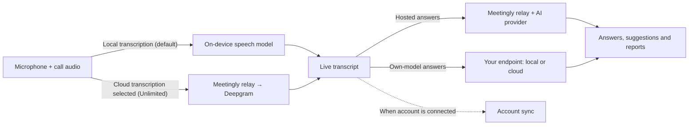

<p align="center"><b>При поддержке <a href="https://aiprimetech.io">AI Prime Tech</a></b>: AI API-шлюз с недорогим доступом к Claude API и Codex API. Один ключ для Claude Code, Codex CLI и моделей GPT.</p>

<div align="center">


# Meetingly: open-source AI-ассистент для собеседований и помощник на встречах

**Ответ — пока вопрос ещё задают.**

Meetingly — бесплатный open-source AI-ассистент для собеседований и живых встреч на Windows, macOS и Linux. Он слушает Zoom, Google Meet, Microsoft Teams или любой другой звонок, расшифровывает его на вашем компьютере и выводит ответ на экран в момент, когда задают вопрос. Используйте бесплатный план (50 ответов в день, без карты) или подключите свой ключ OpenAI, OpenRouter или Ollama. Бесплатная альтернатива Cluely, Interview Coder, Final Round AI, LockedIn AI и Parakeet AI.

<p align="center"><!-- languages --><a href="README.md">English</a> · <a href="README.zh-CN.md">简体中文</a> · <b>Русский</b> · <a href="README.es.md">Español</a> · <a href="README.pt-BR.md">Português</a> · <a href="README.ja.md">日本語</a> · <a href="README.ko.md">한국어</a></p>

<a href="https://meetinglyai.com/download/Meetingly-Setup.exe"></a>
&nbsp;
<a href="https://meetinglyai.com/download/Meetingly-mac-arm64.dmg"></a>
&nbsp;
<a href="https://meetinglyai.com/download/Meetingly-linux.AppImage"></a>

<sub>Также: <a href="https://meetinglyai.com/download/Meetingly-mac-x64.dmg">Intel Mac</a> · <a href="https://meetinglyai.com/download/Meetingly-linux.deb">Debian / Ubuntu (.deb)</a> · <a href="https://meetinglyai.com/download/Meetingly.exe">Windows portable</a> · <a href="https://meetinglyai.com">meetinglyai.com</a></sub>


</div>

## Практические руководства

[Начало работы](https://meetinglyai.com/blog/ai-meeting-assistant-without-bot/) · [Локальные и облачные потоки данных](https://meetinglyai.com/blog/local-vs-cloud-transcription/) · [Настройка Ollama](https://meetinglyai.com/blog/meetingly-ollama-setup/) · [Шаблон заметок встречи](https://meetinglyai.com/blog/meeting-notes-template/)

## Возможности

- **Настоящие ответы — мгновенно.** Когда собеседник что-то спрашивает, нажмите *Answer* (или позвольте автоответчику Pro сделать это): одна жирная фраза, которую можно произнести, а затем несколько ключевых пунктов для развития ответа. Никаких советов и «можно упомянуть…».
- **Подсказки с вопросами.** Боковая колонка следит за разговором и предлагает вопросы в один клик: только что заданный вопрос, всплывшие термины, вероятный следующий вопрос.
- **Распознавание речи на вашем компьютере.** NVIDIA Nemotron по умолчанию расшифровывает локально на 28 языках. Unlimited также предлагает необязательную облачную расшифровку, при которой аудио отправляется в Deepgram.
- **Вы и собеседники — отдельно.** Ваш микрофон и звук звонка расшифровываются раздельно, поэтому расшифровка читается как чат.
- **Анализ экрана.** Один клик считывает то, что на экране (задачу по коду, слайд, вопрос), и отвечает.
- **Защита контента при демонстрации экрана.** Использует защиту ОС на Windows и macOS. Некоторые способы захвата всё равно могут включить окно; Linux не предлагает такой же защиты.
- **Отчёты по встречам.** Каждая встреча заканчивается кратким итогом, решениями, задачами и последующими шагами.
- **Транскрипты сохраняются как текстовые файлы.** Каждый сеанс сохраняется в *Documents/Meetingly* как обычный файл .txt с репликами You и Them, поэтому Meetingly также работает как бесплатное приложение для транскрибации — без AI и аккаунта.
- **Свой API-ключ — или ни одного нашего.** Используйте бесплатный план или подключите Meetingly к OpenAI, OpenRouter, локальной модели Ollama или любому OpenAI-совместимому endpoint.
- **Обновляется сам** на Windows, macOS и Linux — никогда во время звонка.

**Работает с** Zoom, Google Meet, Microsoft Teams, Slack huddles, Discord, Webex и любым другим приложением, которое воспроизводит звонок на вашем компьютере. Бот не подключается к встрече: Meetingly слушает аудио вашего компьютера.

## Для чего его используют

- **Собеседования.** Ответы на поведенческие, технические и HR-вопросы на основе вашего CV и описания вакансии, которые вы один раз вставляете в *Instructions*.
- **Технические собеседования с кодом.** Анализ экрана считывает задачу на экране (LeetCode, HackerRank, CoderPad, Codility или общий редактор) и отвечает подходом и кодом.
- **Продажи и звонки с клиентами.** Ответ на вопрос клиента, пока он ещё говорит, и отчёт со следующими шагами после звонка.
- **Встречи и лекции.** Живая расшифровка на 28 языках, предлагаемые вопросы и резюме с решениями и задачами.

## Два способа использовать

**Бесплатный аккаунт.** Нажмите *Sign up free* на панели: 50 AI-ответов в день, карта не нужна. Инструкции (ваше резюме, описание вакансии), настройки и отчёты по встречам находятся в [web dashboard](https://account.meetinglyai.com) и синхронизируются на все компьютеры.

| | Бесплатный | Lite | Pro | Unlimited |
|---|---|---|---|---|
| Цена | $0 | $9.99 / месяц | $19.99 / месяц, 7 дней бесплатно | $39.99 / месяц |
| Ответы | 50 в день | 150 в день | 300 в день | Без ограничений (при добросовестном использовании) |
| Автоответ (отвечает на вопросы по мере их поступления) | — (нажмите «Ответить») | Включено | Включено | Включено |
| Анализ экрана | 3 в день | 15 в день | 50 в день | 300 в день |
| Подсказки в реальном времени | Около 30 минут в день | Около 2 часов в день | Около 4 часов в день | Около 8 часов в день |
| Отчёты о встречах | 1 в день | 5 в день | 20 в день | 100 в день |
| Компьютеры | 1 | 1 | 2 | 3 |

Оплатите картой, через SBP или криптовалютой на [странице плана](https://account.meetinglyai.com/dashboard/plan). Расскажите о Meetingly и получите Pro бесплатно: см. [creator reward](https://meetinglyai.com/creators/).

**Свой ключ, без аккаунта.** Откройте меню Meetingly (значок в трее рядом с часами) и выберите *Use your own API key…*, выберите провайдера, вставьте ключ и выберите модель. Ответы идут напрямую с вашего компьютера к этому провайдеру; через серверы Meetingly ничего не проходит, а лимиты — только у вашего провайдера.

| Провайдер | API-адрес | Ключ |
|---|---|---|
| OpenAI | `https://api.openai.com/v1` | с platform.openai.com |
| OpenRouter | `https://openrouter.ai/api/v1` | с openrouter.ai |
| Ollama (полностью локально) | `http://localhost:11434/v1` | нет |
| Любой OpenAI-совместимый вариант (LM Studio, vLLM, LiteLLM…) | его адрес `/v1` | если нужен |

Версия 1.2.3 требует защищённое хранилище ключей ОС перед сохранением API-ключа. Существующие ключи в открытом виде переносятся, когда доступно защищённое хранилище; недоступное хранилище ключей не удаляет сохранённую настройку. Для анализа экрана нужна модель, принимающая изображения.

## Meetingly vs Cluely, Pluely, Interview Coder, Final Round AI, LockedIn AI и Parakeet AI

| | **Meetingly** | Cluely | Pluely | Interview Coder | Final Round AI | LockedIn AI | Parakeet AI |
|---|---|---|---|---|---|---|---|
| Цена | **Бесплатно**, Lite $9.99, Pro $19.99, Unlimited $39.99 / месяц | Бесплатный план, Pro $19.99 / месяц | Бесплатно с собственными ключами, Pro от $15 / месяц, $120 навсегда | $299 / месяц или $799 навсегда | Pro от $25 / месяц | $54.99 / месяц или $39.99 / месяц при оплате каждые 3 месяца | €129.90 / месяц или кредиты |
| Бесплатные AI-ответы без собственного ключа | **50 в день, каждый день** | "Limited AI responses" | — | Нет: для AI нужна подписка | Нет: для живых сессий нужен Pro | — | Одна 10-минутная сессия |
| Скрытие при демонстрации экрана | **На каждом плане; действуют ограничения ОС и способа захвата** | Только Pro + Undetectability, $149.99 / месяц | На каждом плане | На каждом плане | Pro | — | Платные планы |
| Linux | **AppImage и .deb** | — | .deb | — | — | — | Только в Chrome |
| Open source | **Apache-2.0** | — | GPL-3.0 | — | — | — | — |
| Использование собственного API-ключа | **OpenAI, OpenRouter, Ollama…** | — | Да | — | — | — | — |
| Распознавание речи на вашем компьютере | **Да, 28 языков** | — | — | — | — | — | — |

<sub>С собственных сайтов продуктов (<a href="https://cluely.com/pricing">cluely.com/pricing</a>, <a href="https://pluely.com/pricing">pluely.com/pricing</a>, <a href="https://www.interviewcoder.co">interviewcoder.co</a>, <a href="https://www.finalroundai.com/pricing">finalroundai.com/pricing</a>, <a href="https://www.lockedinai.com/pricing">lockedinai.com/pricing</a>, <a href="https://www.parakeet-ai.com/pricing">parakeet-ai.com/pricing</a>), 5–11 октября 2026. — означает, что там не упомянуто.</sub>

<div align="center">

</div>

## Как это работает



При выборе локальной расшифровки аудио обрабатывается на вашем компьютере. Выбор облачной расшифровки на Unlimited отправляет аудио через ретранслятор в Deepgram. AI-ответы используют релевантный текст расшифровки, вопросы и запрошенные скриншоты: через размещённый ретранслятор/провайдера или напрямую через ваш собственный endpoint. Синхронизация подключённого аккаунта — отдельный путь данных.

## Примечания по установке

Установщики пока не подписаны кодовой подписью, поэтому при первом запуске появится один запрос:

- **Windows:** SmartScreen сообщит, что приложение не распознано. Нажмите *More info*, затем *Run anyway*.
- **macOS:** откройте System Settings → Privacy & Security и нажмите *Open Anyway*. Держите приложение в Applications, чтобы оно могло обновляться самостоятельно.
- **Linux:** выполните `chmod +x Meetingly-linux.AppImage` и запустите его или установите .deb.

## Разработка

```bash
cd app
npm install
npm run fetch:asr   # speech engine for your platform
npm run dev
```

| Команда | Что делает |
|---|---|
| `npm run dev` | Запуск с горячей перезагрузкой |
| `npm test` | Модульные тесты |
| `npm run typecheck` | Проверка типов main и renderer |
| `npm run smoke` | Открывает каждое окно в headless-режиме и завершается с ошибкой при ошибках renderer (`node scripts/smoke.mjs ownkey` проверяет сценарий с собственным ключом) |
| `npm run dist:win` | Собирает установщик Windows (macOS и Linux собираются в GitHub Actions) |

```
app/      desktop app: Electron 44, React 19, Vite 8, TypeScript, Tailwind
relay/    the small Node service behind the Free, Pro and Unlimited plans (holds the API keys, picks the model per task)
docs/     images for this page
```

## FAQ

### Meetingly бесплатный?

Да. Бесплатный план даёт 50 AI-ответов в день без карты, на одном компьютере. С собственным API-ключом ограничений Meetingly вообще нет. Код открыт под Apache-2.0.

### Meetingly — альтернатива Cluely?

Да. Он делает то же самое (живые ответы в оверлее во время звонка), при этом он open source, также работает на Linux, скрывается при демонстрации экрана на бесплатном плане и работает с вашим API-ключом или локальной моделью.

### Он работает с Zoom, Google Meet и Microsoft Teams?

Да, и с любым другим приложением для звонков. Meetingly захватывает аудио вашего компьютера (loopback на Windows, audio tap на macOS 13 и новее, монитор-устройства PulseAudio на Linux), поэтому к встрече никто не подключается и другая сторона не видит бота.

### Он скрыт при демонстрации экрана? Его невозможно обнаружить?

На Windows и macOS окна используют защиту ОС от захвата экрана, поэтому при демонстрации экрана и в записях они обычно не видны. Некоторые способы захвата всё равно могут их включить, в Linux такой защиты нет, а Meetingly не создан для обхода прокторингового ПО. Ни один инструмент не может честно обещать, что его невозможно обнаружить.

### Может ли он помочь на coding interviews?

Да. Анализ экрана делает скриншот только по вашему нажатию, считывает задачу (LeetCode, HackerRank, CoderPad, Codility или любой редактор) и отвечает подходом и кодом. При использовании собственного ключа выберите модель, которая принимает изображения.

### Можно ли использовать его только для транскрибации, без AI?

Да. Нажмите Listen, и Meetingly транскрибирует звонок на вашем компьютере на 28 языках без ограничения по времени, сохраняя каждый сеанс как файл .txt в *Documents/Meetingly*. Живые подсказки и автоответ отключены; единственный автоматически выполняемый этап с AI — отчёт в конце встречи.

### Может ли он работать полностью офлайн?

Распознавание речи уже работает на вашем компьютере: NVIDIA Nemotron, скачивается один раз (около 560 МБ). Направьте ответы на локальную модель Ollama, и ничего не покинет ваш компьютер.

### Какие языки он поддерживает?

28, как для расшифровки, так и для ответов: английский, арабский, болгарский, китайский, хорватский, чешский, датский, нидерландский, эстонский, финский, французский, немецкий, хинди, венгерский, итальянский, японский, корейский, норвежский, польский, португальский, румынский, русский, словацкий, испанский, шведский, турецкий, украинский и вьетнамский.

### Где хранятся мои данные?

Расшифровки и отчёты сохраняются на вашем компьютере. В бесплатном аккаунте ваши инструкции, настройки и отчёты о встречах также синхронизируются с другими вашими компьютерами. Аудио не хранится. Подробности: [политика конфиденциальности](https://meetinglyai.com/privacy).

## Участие в разработке

Вклады приветствуются, см. [CONTRIBUTING](.github/CONTRIBUTING.md). Вопросы безопасности: [SECURITY](.github/SECURITY.md).

Если Meetingly вам помогает, ⭐ поможет другим людям найти его.

## Спонсор

Бесплатный план Meetingly работает на **[AI Prime Tech](https://aiprimetech.io)** — AI API-шлюзе для моделей Claude, Codex и GPT: недорогой доступ к Claude API и Codex API по одному ключу, с предоплатой или тарифом по времени, с руководствами по настройке Claude Code и Codex CLI.

<div align="center">
<sub>Лицензия Apache-2.0.</sub>
</div>
