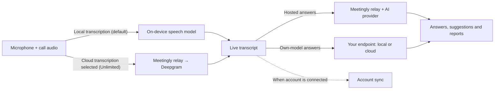

<p align="center"><b>Sponsored by <a href="https://aiprimetech.io">AI Prime Tech</a></b>：一个提供便宜 Claude API 和 Codex API 访问的 AI API 网关。一个密钥即可用于 Claude Code、Codex CLI 和 GPT 模型。</p>

<div align="center">


# Meetingly：开源 AI 面试助手和会议副驾驶

**他们还在问，答案已经出现。**

Meetingly 是一款免费开源的 AI 助手，适用于 Windows、macOS 和 Linux 上的求职面试与实时会议。它会监听 Zoom、Google Meet、Microsoft Teams 或任何其他通话，在你的电脑上转写，并在问题提出时立即把答案显示在屏幕上。可使用免费计划（每天 50 个答案，无需银行卡），或使用你自己的 OpenAI、OpenRouter 或 Ollama 密钥。它是 Cluely、Interview Coder、Final Round AI、LockedIn AI 和 Parakeet AI 的免费替代品。

<p align="center"><!-- languages --><a href="README.md">English</a> · <b>简体中文</b> · <a href="README.ru.md">Русский</a> · <a href="README.es.md">Español</a> · <a href="README.pt-BR.md">Português</a> · <a href="README.ja.md">日本語</a> · <a href="README.ko.md">한국어</a></p>

<a href="https://meetinglyai.com/download/Meetingly-Setup.exe"></a>
&nbsp;
<a href="https://meetinglyai.com/download/Meetingly-mac-arm64.dmg"></a>
&nbsp;
<a href="https://meetinglyai.com/download/Meetingly-linux.AppImage"></a>

<sub>另有：<a href="https://meetinglyai.com/download/Meetingly-mac-x64.dmg">Intel Mac</a> · <a href="https://meetinglyai.com/download/Meetingly-linux.deb">Debian / Ubuntu (.deb)</a> · <a href="https://meetinglyai.com/download/Meetingly.exe">Windows 便携版</a> · <a href="https://meetinglyai.com">meetinglyai.com</a></sub>


</div>

## 实用指南

[快速开始](https://meetinglyai.com/blog/ai-meeting-assistant-without-bot/) · [本地和云端数据流](https://meetinglyai.com/blog/local-vs-cloud-transcription/) · [Ollama 设置](https://meetinglyai.com/blog/meetingly-ollama-setup/) · [会议纪要模板](https://meetinglyai.com/blog/meeting-notes-template/)

## 功能

- **即时给出真实答案。** 对方提问时，按下 *Answer*（或让 Pro 自动回答）：先给出一句你可以直接说的加粗回答，再提供几个可展开的要点。不提供指导，也不会说“你可以提到……”。
- **问题建议。** 侧边栏会跟随对话并提供一键提问：刚刚被问到的问题、出现过的术语、可能的下一个问题。
- **在你的电脑上进行语音识别。** NVIDIA Nemotron 默认支持 28 种语言的本地转写。Unlimited 还提供可选的云端转写，会将音频发送到 Deepgram。
- **你和对方，分开记录。** 你的麦克风和通话音频会分别转写，因此转写稿读起来像聊天记录。
- **屏幕分析。** 一键读取屏幕内容（编程题、幻灯片、问题）并给出答案。
- **屏幕共享内容保护。** 在 Windows 和 macOS 上使用操作系统保护。某些捕获方式仍可能包含该窗口；Linux 不提供同等保护。
- **会议报告。** 每场会议结束后都会生成摘要、决策、行动项和后续事项。
- **转录内容保存为文本文件。** 每次会话都会以纯文本 .txt 文件保存到 *Documents/Meetingly*，并在每轮对话中标明 You 和 Them，因此 Meetingly 也可以作为免费的转录应用使用，无需 AI，也无需账号。
- **使用你自己的 API 密钥，或不使用我们的。** 使用免费计划，或将 Meetingly 指向 OpenAI、OpenRouter、本地 Ollama 模型或任何兼容 OpenAI 的端点。
- 在 Windows、macOS 和 Linux 上**自动更新**，且绝不会在通话过程中更新。

**适用于** Zoom、Google Meet、Microsoft Teams、Slack huddles、Discord、Webex 以及任何在你电脑上播放通话的应用。没有机器人加入会议：Meetingly 会监听你电脑的音频。

## 大家用它做什么

- **求职面试。** 根据你的简历和职位描述回答行为、技术和 HR 问题；你只需将它们粘贴到 *Instructions* 一次。
- **编程面试。** 屏幕分析会读取屏幕上的题目（LeetCode、HackerRank、CoderPad、Codility 或共享编辑器），并给出思路和代码。
- **销售和客户通话。** 在客户还在说话时给出问题答案，并在之后生成包含后续步骤的报告。
- **会议和讲座。** 提供 28 种语言的实时转写、建议问题，以及包含决策和行动项的总结。

## 两种使用方式

**免费账号。** 在面板中点击 *Sign up free*：每天 50 次 AI 回答，无需银行卡。说明（你的简历、职位描述）、设置和会议报告都在你的 [网页仪表盘](https://account.meetinglyai.com) 中，并同步到每台电脑。

| | 免费 | Lite | Pro | Unlimited |
|---|---|---|---|---|
| 价格 | $0 | $9.99 / 月，免费 7 天 | $19.99 / 月 | $39.99 / 月 |
| 回答 | 每天 50 次 | 每天 150 次 | 每天 300 次 | 无限（合理使用） |
| 自动回答（问题提出时自动回答） | —（按下“回答”） | 包含 | 包含 | 包含 |
| 屏幕分析 | 每天 3 次 | 每天 15 次 | 每天 50 次 | 每天 300 次 |
| 实时建议 | 每天约 30 分钟 | 每天约 2 小时 | 每天约 4 小时 | 每天约 8 小时 |
| 会议报告 | 每天 1 份 | 每天 5 份 | 每天 20 份 | 每天 100 份 |
| 设备数 | 1 | 1 | 2 | 3 |

可在[计划页面](https://account.meetinglyai.com/dashboard/plan)用银行卡、SBP 或加密货币支付。发布关于 Meetingly 的内容可免费获得 Pro：查看[创作者奖励](https://meetinglyai.com/creators/)。

**使用自己的密钥，无需账号。** 打开 Meetingly 菜单（时钟旁的托盘图标），选择 *Use your own API key…*，选择提供商，粘贴密钥并选择模型。答案会直接从你的电脑发送到该提供商；不会经过 Meetingly 的服务器，限制也只有你的提供商设定的限制。

| 提供商 | API 地址 | 密钥 |
|---|---|---|
| OpenAI | `https://api.openai.com/v1` | 来自 platform.openai.com |
| OpenRouter | `https://openrouter.ai/api/v1` | 来自 openrouter.ai |
| Ollama（完全本地） | `http://localhost:11434/v1` | 无 |
| 任何兼容 OpenAI 的服务（LM Studio、vLLM、LiteLLM…） | 它的 `/v1` 地址 | 如果需要的话 |

版本 1.2.3 在保存 API 密钥前需要安全的操作系统钥匙串。安全存储可用时，现有明文密钥会迁移；钥匙串不可用不会清除已保存的设置。屏幕分析需要支持图像的模型。

## Meetingly 对比 Cluely、Pluely、Interview Coder、Final Round AI、LockedIn AI 和 Parakeet AI

| | **Meetingly** | Cluely | Pluely | Interview Coder | Final Round AI | LockedIn AI | Parakeet AI |
|---|---|---|---|---|---|---|---|
| 价格 | **免费**，Lite $9.99、Pro $19.99、Unlimited $39.99 / 月 | 免费计划，Pro $19.99 / 月 | 使用自己的密钥免费，Pro $15 / 月起，终身 $120 | $299 / 月或终身 $799 | Pro $25 / 月起 | $54.99 / 月，或每 3 个月计费 $39.99 / 月 | €129.90 / 月，或使用点数 |
| 无需自有密钥的免费 AI 答案 | **每天 50 个，每天都有** | "Limited AI responses" | — | 无：AI 需要订阅 | 无：实时会话需要 Pro | — | 一个 10 分钟会话 |
| 屏幕共享中隐藏 | **所有计划；受操作系统和捕获方式限制** | 仅 Pro + Undetectability，$149.99 / 月 | 所有计划 | 所有计划 | Pro | — | 付费计划 |
| Linux | **AppImage 和 .deb** | — | .deb | — | — | — | 仅 Chrome |
| 开源 | **Apache-2.0** | — | GPL-3.0 | — | — | — | — |
| 使用你自己的 API 密钥 | **OpenAI、OpenRouter、Ollama…** | — | 是 | — | — | — | — |
| 在你的电脑上进行语音识别 | **是，28 种语言** | — | — | — | — | — | — |

<sub>来自各产品官网（<a href="https://cluely.com/pricing">cluely.com/pricing</a>、<a href="https://pluely.com/pricing">pluely.com/pricing</a>、<a href="https://www.interviewcoder.co">interviewcoder.co</a>、<a href="https://www.finalroundai.com/pricing">finalroundai.com/pricing</a>、<a href="https://www.lockedinai.com/pricing">lockedinai.com/pricing</a>、<a href="https://www.parakeet-ai.com/pricing">parakeet-ai.com/pricing</a>），2026 年 10 月 5–11 日。— 表示该处未提及。</sub>

<div align="center">

</div>

## 工作原理



选择本地转写时，音频会在你的电脑上处理。选择 Unlimited 的云端转写会通过中继将音频发送到 Deepgram。AI 答案会使用相关转写文本、问题和请求的截图：通过托管中继/提供商，或直接通过你自己的端点。已连接账户同步是单独的数据路径。

## 安装说明

安装包尚未进行代码签名，因此首次启动时会提示一次：

- **Windows:** SmartScreen 会提示该应用无法识别。点击 *More info*，然后点击 *Run anyway*。
- **macOS:** 打开系统设置 → 隐私与安全性，然后点击 *Open Anyway*。请将应用保留在“应用程序”中，以便它自行更新。
- **Linux:** 执行 `chmod +x Meetingly-linux.AppImage` 并运行它，或安装 .deb。

## 开发

```bash
cd app
npm install
npm run fetch:asr   # speech engine for your platform
npm run dev
```

| 命令 | 作用 |
|---|---|
| `npm run dev` | 以热重载方式运行 |
| `npm test` | 单元测试 |
| `npm run typecheck` | 对 main 和 renderer 进行类型检查 |
| `npm run smoke` | 以无头模式打开每个窗口，并在 renderer 出错时失败（`node scripts/smoke.mjs ownkey` 测试自带密钥流程） |
| `npm run dist:win` | 构建 Windows 安装包（macOS 和 Linux 在 GitHub Actions 中构建） |

```
app/      desktop app: Electron 44, React 19, Vite 8, TypeScript, Tailwind
relay/    the small Node service behind the Free, Pro and Unlimited plans (holds the API keys, picks the model per task)
docs/     images for this page
```

## FAQ

### Meetingly 免费吗？

是。免费计划在一台电脑上每天提供 50 个 AI 答案，无需银行卡。使用你自己的 API 密钥时，Meetingly 完全不设限制。代码以 Apache-2.0 开源。

### Meetingly 是 Cluely 的替代品吗？

是。它完成同样的工作（通话时在叠加层实时给出答案），并且开源，也能在 Linux 上运行，免费计划也可在屏幕共享中隐藏，并支持使用你自己的 API 密钥或本地模型。

### 它支持 Zoom、Google Meet 和 Microsoft Teams 吗？

支持，也支持任何其他通话应用。Meetingly 会捕获你电脑的音频（Windows 上的 loopback，macOS 13 及更高版本上的 audio tap，Linux 上的 PulseAudio 监听设备），因此不会有任何东西加入会议，对方也看不到机器人。

### 它会在屏幕共享中隐藏吗？它不可检测吗？

在 Windows 和 macOS 上，窗口使用操作系统的屏幕捕获保护，因此屏幕共享和录制通常不会包含它们。某些捕获方式仍可能包含它们，Linux 没有这种保护，而且 Meetingly 并不是为绕过监考软件而构建的。没有任何工具能诚实地承诺不可检测。

### 它能帮助编程面试吗？

能。屏幕分析只会在你按下时截图，读取题目（LeetCode、HackerRank、CoderPad、Codility 或任何编辑器），并给出思路和代码。使用你自己的密钥时，请选择支持图像的模型。

### 我可以只用它进行转录而不使用 AI 吗？

可以。点击 Listen 后，Meetingly 会在你的电脑上以 28 种语言转录通话，不限时长，并将每次会话保存为 *Documents/Meetingly* 中的 .txt 文件。实时建议和自动回答默认关闭；唯一会自动运行的 AI 功能是会议结束时生成报告。

### 它能完全离线运行吗？

语音识别已经在你的电脑上运行：NVIDIA Nemotron，只需下载一次（约 560 MB）。将答案指向本地 Ollama 模型，就不会有任何内容离开你的电脑。

### 它支持哪些语言？

28 种，转写和答案都支持：英语、阿拉伯语、保加利亚语、中文、克罗地亚语、捷克语、丹麦语、荷兰语、爱沙尼亚语、芬兰语、法语、德语、印地语、匈牙利语、意大利语、日语、韩语、挪威语、波兰语、葡萄牙语、罗马尼亚语、俄语、斯洛伐克语、西班牙语、瑞典语、土耳其语、乌克兰语和越南语。

### 我的数据存储在哪里？

转录和报告会保存在你的电脑上。使用免费账户时，你的 Instructions、设置和会议报告也会同步到你的其他电脑。音频不会被存储。详情：[隐私政策](https://meetinglyai.com/privacy)。

## 贡献

欢迎贡献，参见 [CONTRIBUTING](.github/CONTRIBUTING.md)。安全问题： [SECURITY](.github/SECURITY.md)。

如果 Meetingly 对你有帮助，点一个 ⭐ 可以帮助更多人发现它。

## 赞助

Meetingly 的免费计划运行在 **[AI Prime Tech](https://aiprimetech.io)** 上，这是一个面向 Claude、Codex 和 GPT 模型的 AI API 网关：用一个密钥即可低成本访问 Claude API 和 Codex API，支持预付费或按时长套餐，并提供 Claude Code 和 Codex CLI 的设置指南。

<div align="center">
<sub>Apache-2.0 许可。</sub>
</div>
